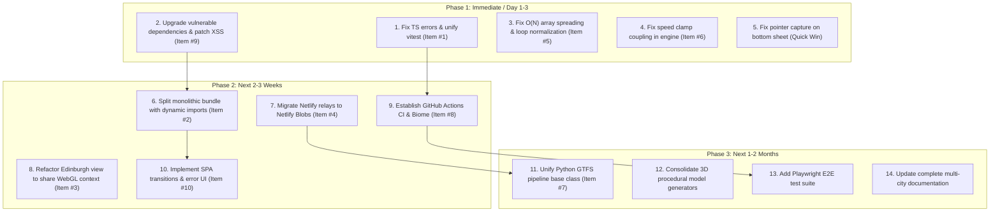

# Comprehensive Architectural & Engineering Audit Report
**Project:** Paris Subway 3D (Multi-City 3D Transit Visualizer)  
**Evaluator:** Senior Staff Engineer & Software Architect  
**Date:** November 2026  
**Scope:** Full repository audit (Frontend, Simulation Engine, Ingestion Pipeline, Serverless Relays, CI/CD, Documentation, Dependencies, UX/Accessibility, Security)

---

## 1. Executive Summary

This project is a high-ambition, visually striking web application that simulates metropolitan transit networks in real time on a 3D cartographic canvas (combining MapLibre GL, deck.gl, and in some views Three.js). Originally conceived as an interactive digital twin of the Paris Métro and RER using IDFM PRIM SIRI-Lite feeds, the codebase has aggressively expanded into a multi-city platform now supporting **Paris, Montreal, London, Lille, Washington DC, Berlin, and Edinburgh**.

The simulation engine's core mathematics—autonomous in-browser trapezoidal kinematics, smoothed bearing calculations along pre-projected monotonic curvilinear shapes (`shapes.bin`), and a multi-tiered confidence model (`measured`, `bracketed`, `extrapolated`, `scheduled`)—represent genuinely sophisticated domain engineering. When running smoothly, the user experience is fluid and informative.

However, rapid feature velocity and city expansion have incurred severe architectural debt. The codebase sits at an inflection point:
1. **Monolithic Bundle & Architectural Sprawl:** The application bundles all seven cities, all real-time adapters, and hardcoded dictionaries (e.g. 560 lines of Berlin station mappings) into a single monolithic 2.63 MB client chunk (`main.js`). Switching cities triggers a hard browser reload (`window.location.href`). In Edinburgh, a full Three.js scene runs concurrently with MapLibre GL and deck.gl on an overlaid DOM element with global `window.fetch` monkeypatching.
2. **Serverless Relay Instability:** Netlify functions rely on ephemeral in-memory caching (`cachedSnapshot = null`). In serverless lambda environments where instances are spun up and torn down dynamically, scheduled background crons do not share memory with incoming HTTP requests, triggering sequential upstream API calls (e.g. 21 sequential HTTP requests taking 10+ seconds for Paris PRIM) that threaten execution timeouts and upstream 429 rate limits.
3. **Severe Code Duplication:** Each new city was introduced by copying and pasting 800–1,700 lines of Python ingestion scripts and 400 lines of procedural 3D GLB model generators, duplicating GTFS parsing, shape resampling, and protobuf decoding across the repository.
4. **Developer Infrastructure Vacuum:** There is **zero CI/CD automation** (no GitHub Actions), no linter, no formatter, and no root typecheck script. Root `tsc --noEmit` fails with 3 type errors; Python `pytest` fails with `ModuleNotFoundError`; and `npm run test` executes 20 subshells sequentially taking 30+ seconds instead of running vitest in 4.7 seconds, while omitting 7 test suites entirely.

### Dimension Health Scores (1–10)

| Dimension | Score | Primary Rationale |
| :--- | :---: | :--- |
| **1. Architecture & Design** | **5 / 10** | High-level kinematic domain model is strong, but monolithic bundling, hardcoded city couplings, and Edinburgh Three.js hack compromise structure. |
| **2. Code Quality** | **4 / 10** | Over 6,500 lines of copy-pasted Python ingest code; ad-hoc directories (`fixing du 3D`, `audit/design/` with 60MB PNGs); bloated 1,170-line `main.ts`. |
| **3. Performance** | **5 / 10** | 2.63 MB JS bundle; ~20 MB data download on initial Paris load; three simultaneous WebGL contexts in Edinburgh; O(N) array spreading in 1 Hz loop. |
| **4. Security** | **4 / 10** | 18 npm vulnerabilities (3 Critical, 11 High including MapLibre XSS bypass and Tinypool RCE); unescaped HTML in tooltip interpolation; wildcard CORS on all relays. |
| **5. Reliability & Error Handling** | **5 / 10** | Any single failed asset download causes an infinite blank loading screen; empty `catch {}` blocks in relays; lambda timeouts on sequential PRIM requests. |
| **6. Testing** | **6 / 10** | Good unit snapshot tests for kinematics, but `npm test` runs 20 sequential spawns and skips 7 test files; broken Python test harness; 0 browser E2E tests. |
| **7. Dependencies** | **5 / 10** | Mismatched deck.gl (9.1.4) and mesh-layers/luma.gl (9.4.0); vulnerable dependencies; duplicate luxon definitions; dead pnpm workspace config. |
| **8. Developer Experience** | **3 / 10** | No CI/CD; no ESLint/Prettier/Biome; root `tsc` fails; build requires ad-hoc Python step; Python tests fail without manual `PYTHONPATH`. |
| **9. User Experience & Accessibility** | **6 / 10** | Visually polished 3D aesthetic and good typography, but hard reload on city switch; broken pointer-capture on sheet drag; 20 MB first-render payload. |
| **10. Documentation** | **4 / 10** | Original Paris docs are well-written, but completely obsolete: zero documentation for the 6 new cities or the multi-city architecture. |
| **11. Observability** | **3 / 10** | No client-side error reporting (no Sentry); unindexed console logs in lambdas without correlation IDs; no WebGL memory/FPS monitoring. |
| **12. Scalability & Future-Proofing** | **3 / 10** | Adding a new city requires writing ~2,000 lines of boilerplate; Git repo bloats with binary shapes and 3D models; serverless cron limits near capacity. |

---

## 2. Project Understanding

### Purpose & User Base
The application is a browser-based, high-framerate 3D digital twin of public transit systems. It serves transit enthusiasts, urban cartography professionals, and daily commuters by animating trains along their actual 3D paths according to scheduled timetables and live real-time adjustments (delays, cancellations, disrupted segments).

### Technology Stack
- **Frontend Core:** TypeScript 5.7, Vite 6.1 (migrated from standard port 5173 to custom port 3000), Vanilla Web Components/DOM classes (no React/Vue framework overhead).
- **Map & 3D Visualization:** MapLibre GL JS 5.24 (vector tiles via OpenFreeMap, terrain DEM, building extrusions), deck.gl 9.1 (`MapboxOverlay`, `PathLayer`, `ScenegraphLayer`, custom `CapsuleLayer`), Three.js 0.187 (for Edinburgh regional relief and Class 385 EMU rendering).
- **Time & Kinematics:** Luxon (handling timezones Europe/Paris, America/Montreal, Europe/London, America/New_York, Europe/Berlin), custom trapezoidal kinematics calculator with smoothed bearing lookahead.
- **Backend & Serverless Relays:** Netlify Functions (TypeScript on AWS Lambda, bundled with esbuild, scheduled via cron syntax), handling PRIM SIRI-Lite (Paris), STM i3 (Montreal), TfL Unified API (London), Ilévia GTFS-RT (Lille), WMATA GTFS-RT (Washington), and VBB GTFS-RT (Berlin).
- **Data Ingestion:** Python 3.9+ scripts utilizing `shapely`, `requests`, and `protobuf`/`pbf` to parse GTFS feeds, project coordinates onto 3D elevation tracks, and output proprietary binary shapes (`shapes.bin` via SHP2 format) and precomputed `line_ladders.json`.

---

## 3. Top 10 Highest-Leverage Improvements
*Ranked by Impact-to-Effort ratio.*

### 1. Fix TypeScript Errors and Replace the 20-Subshell Test Command with Unified Vitest
- **What's wrong:**
  1. `package.json:31` defines `"test"` by chaining 20 individual `npm run test:*` commands with `&&`. Each runs a separate `vitest run <file>` node process. This takes **30+ seconds** and hides failures in omitted test files.
  2. Running `npx vitest run` directly runs all 34 test files in **4.76 seconds** (a 6.3x speedup!), but reveals that 7 test files in `tests/` are completely omitted from `package.json` (e.g. `tests/london-vicious-cases.test.ts`, `tests/dst_transitions.test.ts`).
  3. Running `npx tsc --noEmit` from the root fails with 3 compile errors:
     - [core/sim/browser_engine.ts#L450](file:///Users/morgancanteri/Documents/Paris%20subway%203D/core/sim/browser_engine.ts#L450): `Property 'suppressedTripIds' does not exist on type 'void | RealtimeTickResult'`.
     - [netlify/functions/lille_relay.ts#L50](file:///Users/morgancanteri/Documents/Paris%20subway%203D/netlify/functions/lille_relay.ts#L50): `Property 'scheduleRelationship' does not exist on type 'IleviaStopTimeUpdate'`.
     - [tests/london-vicious-cases.test.ts#L23](file:///Users/morgancanteri/Documents/Paris%20subway%203D/tests/london-vicious-cases.test.ts#L23): `Type 'Float32Array' is not assignable to type 'Float64Array'`.
- **Why it matters:** Broken typechecks and an excruciating 30-second test loop deter continuous verification and mask latent type bugs across production code.
- **Recommended fix:**
  - In `core/sim/browser_engine.ts#L450`, check `if (result && 'suppressedTripIds' in result && result.suppressedTripIds)`.
  - In `cities/lille/rt/types.ts#L17`, add `scheduleRelationship?: number;` to `IleviaStopTimeUpdate`.
  - In `tests/london-vicious-cases.test.ts#L9`, change `new Float32Array(...)` to `new Float64Array(...)`.
  - In `package.json#L31`, replace the chained script with:
    ```json
    "test": "vitest run && node tests/verify_build_footprint.mjs",
    "typecheck": "tsc --noEmit"
    ```
- **Impact:** High | **Effort:** S (45 min) | **Confidence:** High

---

### 2. Dynamically Import City Configurations and Realtime Adapters (Bundle Code-Splitting)
- **What's wrong:**
  [cities/index.ts#L1-L10](file:///Users/morgancanteri/Documents/Paris%20subway%203D/cities/index.ts#L1-L10) and [cities/realtime.ts#L1-L10](file:///Users/morgancanteri/Documents/Paris%20subway%203D/cities/realtime.ts#L1-L10) statically import every city config, every realtime adapter, every client, and large static dictionaries (such as [cities/berlin/rt/station_map.ts](file:///Users/morgancanteri/Documents/Paris%20subway%203D/cities/berlin/rt/station_map.ts), which is 560 lines).
  Consequently, `web/dist/assets/main-BhZZ2zpQ.js` balloons to **2,632 kB (2.63 MB)**. A user in Paris downloading the page is forced to download all JavaScript code for London, Berlin, Washington, Montreal, Lille, and Edinburgh.
- **Why it matters:** Slower initial page load (FCP/LCP), high mobile memory pressure, and unnecessary cellular data consumption.
- **Recommended fix:**
  Convert city configs and realtime adapters to dynamic imports keyed by city slug:
  ```ts
  // cities/index.ts
  export const CITY_LOADERS: Record<string, () => Promise<CityConfig>> = {
    paris: () => import('./paris/city.config').then(m => m.parisConfig),
    berlin: () => import('./berlin/city.config').then(m => m.berlinConfig),
    // ...
  };
  ```
- **Impact:** Critical | **Effort:** M (1 day) | **Confidence:** High

---

### 3. Eliminate Dual Concurrent 3D Engines & Fetch Monkeypatching in Edinburgh View
- **What's wrong:**
  1. In [web/src/main.ts#L306-L314](file:///Users/morgancanteri/Documents/Paris%20subway%203D/web/src/main.ts#L306-L314), when `cityConfig.id === 'edinburgh'`, the application overrides global `window.fetch` to intercept hardcoded file strings:
     ```ts
     const origFetch = window.fetch;
     window.fetch = function(input, init) {
       if (typeof input === 'string' && (input.includes('wmata_generic__neutral.glb') || input.includes('steel_classic__neutral.glb'))) {
         return origFetch('/models/train/scotrail_class_385__neutral.glb', init);
       }
       return origFetch(input, init);
     };
     ```
  2. In [web/src/main.ts#L1110-L1136](file:///Users/morgancanteri/Documents/Paris%20subway%203D/web/src/main.ts#L1110-L1136), Edinburgh mounts a brand-new `Three.js` canvas (`#edinburgh-three-container`) at `z-index: 2` over the active MapLibre GL map and deck.gl overlay. **All three WebGL contexts render simultaneously at 60 FPS**, each with its own render loop, shadow maps, and listeners.
- **Why it matters:** Monkeypatching global `fetch` is brittle and leaks across route changes. Running three active WebGL contexts causes WebGL context loss on mobile devices, drains battery, and spikes GPU memory.
- **Recommended fix:**
  - Configure the model asset URL properly in `rolling-stock.json` / `city.config.ts` instead of intercepting `fetch`.
  - When Edinburgh Three.js view is active, pause/hide the MapLibre/deck.gl animation loop (`engine.stop()`, cancel MapLibre `requestAnimationFrame`), or port Edinburgh relief into a deck.gl `SimpleMeshLayer`/`TerrainLayer` to share a single WebGL context.
- **Impact:** Critical | **Effort:** M (1-2 days) | **Confidence:** High

---

### 4. Migrate Serverless In-Memory State to Netlify Blobs / Edge Storage
- **What's wrong:**
  In [netlify/functions/prim_relay.ts#L664-L716](file:///Users/morgancanteri/Documents/Paris%20subway%203D/netlify/functions/prim_relay.ts#L664-L716), caching relies entirely on module-level variables: `let cachedSnapshot: PrimSnapshot | null = null;` and `let lastFetchEpoch = 0;`.
  The same pattern is repeated in `washington_relay.ts`, `berlin_relay.ts`, and `stm_relay.ts`.
- **Why it matters:** In serverless architectures (AWS Lambda), container instances are ephemeral. Netlify Scheduled Functions run in their own container and update their own local memory. When users visit the site, their HTTP requests hit different warm or cold containers where `cachedSnapshot === null`. The function then executes [prim_relay.ts#L631-L655](file:///Users/morgancanteri/Documents/Paris%20subway%203D/netlify/functions/prim_relay.ts#L631-L655), querying **21 transit lines sequentially with 150ms delays** (10–15 seconds total). This leads to Netlify gateway timeouts (10s limit on standard tier) and PRIM HTTP 429 rate limits.
- **Recommended fix:**
  Store the serialized snapshot in `@netlify/blobs` or an edge KV store (Upstash Redis) with a shared TTL:
  ```ts
  import { getStore } from '@netlify/blobs';
  const store = getStore('realtime-snapshots');
  // Scheduled cron writes:
  await store.setJSON('prim-latest', snapshot);
  // User request reads:
  const cached = await store.get('prim-latest', { type: 'json' });
  ```
- **Impact:** High | **Effort:** M (1 day) | **Confidence:** High

---

### 5. Remove O(N) Array Spread and Repetitive Normalization in the 1 Hz Engine Loop
- **What's wrong:**
  1. In [core/sim/browser_engine.ts#L368-L369](file:///Users/morgancanteri/Documents/Paris%20subway%203D/core/sim/browser_engine.ts#L368-L369):
     ```ts
     const firstMetroSeconds = Math.min(...this.trips.map(trip => trip.t0));
     const lastServiceSeconds = Math.max(...this.trips.map(trip => trip.t1));
     ```
     `this.trips` contains **11,252 items** in Paris! Spreading an 11,000-item array into `Math.min` risks `RangeError: Maximum call stack size exceeded`. Furthermore, this allocates two new 11,252-element arrays every second inside `getServiceStatus()`.
  2. In [core/sim/browser_engine.ts#L480-L491](file:///Users/morgancanteri/Documents/Paris%20subway%203D/core/sim/browser_engine.ts#L480-L491), for every active train on every tick, it re-normalizes string names in a nested loop:
     ```ts
     const isInsideClosedSection = trip.stops.some(s => {
       const normStop = normalizeStopName(s[3]);
       return lineTraffic.closedStations!.some(cs => {
         const normCs = normalizeStopName(cs);
         return (normStop.includes(normCs) || normCs.includes(normStop));
       });
     });
     ```
- **Why it matters:** Pointless garbage collection pressure and CPU frame drops occurring every 1,000 ms on low-power mobile devices.
- **Recommended fix:**
  - Compute `firstMetroSeconds` and `lastServiceSeconds` **once** when `this.trips` is loaded during `initialize()`.
  - Pre-normalize `lineTraffic.closedStations` once when traffic updates arrive, storing them in a `Set<string>`.
- **Impact:** High | **Effort:** S (1 hour) | **Confidence:** High

---

### 6. Remove Hardcoded Paris RER Logic from General Browser Engine
- **What's wrong:**
  In [core/sim/browser_engine.ts#L533](file:///Users/morgancanteri/Documents/Paris%20subway%203D/core/sim/browser_engine.ts#L533):
  ```ts
  const maxDisplaySpeed = isRerLine(trip.line) ? 130 : 90;
  const speedKmh = Math.round(Math.min(maxDisplaySpeed, vMps * 3.6));
  ```
  `browser_engine.ts` directly imports `isRerLine` from [core/rt/rt_matching.ts#L92](file:///Users/morgancanteri/Documents/Paris%20subway%203D/core/rt/rt_matching.ts#L92), which checks a hardcoded set of Paris RER IDs (`IDFM:C01742`, etc.).
- **Why it matters:** In Edinburgh, ScotRail Class 385 trains operate at 160 km/h (defined in `edinburghConfig.modes[0].kinematics.maxSpeedKmh = 160`). Because Edinburgh lines are not in Paris `RER_LINE_IDS`, **their speed is artificially clamped to 90 km/h**. The core simulation engine is tightly coupled to Paris IDs.
- **Recommended fix:**
  Derive the speed clamp directly from the active line's mode kinematics:
  ```ts
  const modeKinematics = this.getModeKinematics(trip.line);
  const maxDisplaySpeed = modeKinematics?.maxSpeedKmh ?? 90;
  ```
- **Impact:** Medium | **Effort:** S (30 min) | **Confidence:** High

---

### 7. Consolidate Duplicate GTFS Python Pipelines and 3D Model Generators
- **What's wrong:**
  Across `core/ingest/` and `cities/*/ingest/`, there are **7 distinct Python scripts** totaling over 6,500 lines:
  - `build_london_artifacts.py`: 1,685 lines
  - `build_lille_artifacts.py`: 1,289 lines
  - `build_washington_artifacts.py`: 861 lines
  - `build_berlin_artifacts.py`: 852 lines
  - `build_edinburgh_artifacts.py`: 846 lines
  - `build_montreal_artifacts.py`: 733 lines
  - `build_artifacts.py` (Paris): 560 lines
  
  Similarly, procedural GLB builders are duplicated per city: `build_berlin_train_models.py` (402 lines), `build_washington_train_models.py` (393 lines), `build_edinburgh_train_models.py` (363 lines), `build_lille_train_models.py` (434 lines), `build_rer_box_models.py` (605 lines).
- **Why it matters:** A bug fix or optimization in shape projection, monotonicity validation, or GLB node naming has to be manually replicated across 7 different Python scripts. Inevitably, implementations diverge (e.g., differing tolerance thresholds, unverified kinematics flags).
- **Recommended fix:**
  Create a unified `BaseGtfsPipeline` class in `core/ingest/` that accepts a `city.config.json` defining agency filters, route types, and shape projection parameters. City-specific ingest scripts should only declare configuration overrides.
- **Impact:** High | **Effort:** L (3-4 days) | **Confidence:** High

---

### 8. Set Up CI/CD Workflow, Linter, and Formatter
- **What's wrong:**
  - The repository has **no `.github/` folder** and no continuous integration.
  - There is no linter (`eslint` or `biome`) or code formatter (`prettier`) configured in `package.json`.
  - The repo contains untracked formatting drift, unused imports, and silent type errors.
  - `pnpm-workspace.yaml` exists alongside `package.json` workspaces and `package-lock.json`, causing package manager ambiguity.
- **Why it matters:** Regression prevention is entirely manual. Broken builds, failing tests, and security vulnerabilities can be pushed directly to production without gating.
- **Recommended fix:**
  1. Remove `pnpm-workspace.yaml` to standardize on `npm`.
  2. Install and initialize Biome (`npx @biomejs/biome init`) for fast linting and formatting.
  3. Create `.github/workflows/ci.yml` running:
     ```yaml
     name: CI
     on: [push, pull_request]
     jobs:
       test:
         runs-on: ubuntu-latest
         steps:
           - uses: actions/checkout@v4
           - uses: actions/setup-node@v4
             with: { node-version: 20, cache: 'npm' }
           - run: npm ci
           - run: npx tsc --noEmit
           - run: npm test
           - run: npm run build:web
     ```
- **Impact:** High | **Effort:** S (1-2 hours) | **Confidence:** High

---

### 9. Sanitize HTML String Interpolation in Tooltips & Modals (XSS Prevention)
- **What's wrong:**
  In [web/src/main.ts#L655-L660](file:///Users/morgancanteri/Documents/Paris%20subway%203D/web/src/main.ts#L655-L660) and [web/src/main.ts#L717-L733](file:///Users/morgancanteri/Documents/Paris%20subway%203D/web/src/main.ts#L717-L733):
  ```ts
  tooltipEl.innerHTML = `
    <div class="tooltip-name">${st.name}</div>
    ...
    <span class="train-tooltip-dest">${tr.dest}</span>
    <div>Prochain arrêt : <strong>${tr.next || '—'}</strong></div>
  `;
  ```
  `st.name`, `tr.dest`, and `tr.next` originate from GTFS stop names and real-time headsign strings. They are inserted directly into `innerHTML` without HTML entity encoding.
  (In [main.ts#L56](file:///Users/morgancanteri/Documents/Paris%20subway%203D/web/src/main.ts#L56), an `escapeHtml` function was written specifically for network records, but never reused for map tooltips).
  Additionally, `npm audit` flags a Critical vulnerability in `maplibre-gl <= 6.4.0` for DOM sanitization bypass.
- **Why it matters:** Third-party transit feeds with unescaped XML or crafted payload strings can execute arbitrary script in the client origin.
- **Recommended fix:**
  Extract `escapeHtml` to a shared utility and wrap all dynamic data strings before interpolating into `innerHTML`, or create elements via `document.createElement` and assign `.textContent`. Update `maplibre-gl` to `>=6.16.0`.
- **Impact:** High | **Effort:** S (1 hour) | **Confidence:** High

---

### 10. Implement Client-Side SPA Transitions and Fail-Safe Loading Recovery
- **What's wrong:**
  1. In [web/src/main.ts#L872-L875](file:///Users/morgancanteri/Documents/Paris%20subway%203D/web/src/main.ts#L872-L875):
     ```ts
     onCitySelect: (cityId: string) => {
       router.setCity(cityId);
       window.location.href = `/${cityId}`;
     }
     ```
     Switching cities issues a hard document navigation, forcing the browser to reload the HTML, re-parse 2.6 MB of JS, and re-download MapLibre vector style definitions.
  2. In [web/src/main.ts#L334-L345](file:///Users/morgancanteri/Documents/Paris%20subway%203D/web/src/main.ts#L334-L345) and [web/src/main.ts#L1168-L1170](file:///Users/morgancanteri/Documents/Paris%20subway%203D/web/src/main.ts#L1168-L1170):
     `Promise.all` fetches 9 resources simultaneously. If any one of them fails (network glitch, missing file), the top-level promise rejects into:
     ```ts
     bootstrap().catch(err => console.error('[app] Bootstrap error:', err));
     ```
     The `#app-loader` spinner remains on screen permanently. The user is trapped on a blank loading screen with zero error message, diagnostic context, or retry button.
- **Why it matters:** High friction when exploring multiple cities, and fragile first-time user experience on unstable mobile connections.
- **Recommended fix:**
  - Wrap data fetching with individual error handling and present a user-facing error dialog with a "Réessayer" (Retry) action.
  - Implement a `switchCity(cityConfig)` routine in `main.ts` that unmounts existing overlay layers, clears engine timers, updates camera bounds, and loads new data dynamically without refreshing the window.
- **Impact:** High | **Effort:** M (1-2 days) | **Confidence:** High

---

## 4. Quick Wins
*High-impact, low-effort changes that can be implemented today.*

1. **Delete Dead Git-Tracked PNGs in `audit/design/`:**
   - [audit/design/](file:///Users/morgancanteri/Documents/Paris%20subway%203D/audit/design/) contains 81 files (over 60 MB) of historical audit screenshots from September 2026. Remove them from git tracking (`git rm -r audit/design/*.png`) to reduce clone weight.
2. **Remove Unused Empty / Stale Directories:**
   - Remove `assets-src/` (contains only `.DS_Store`).
   - Clean up `fixing du 3D/` (contains redundant copies of `capsule_layer.ts`, etc.).
3. **Remove Stale `.js` Files in `engine/src/`:**
   - [engine/src/](file:///Users/morgancanteri/Documents/Paris%20subway%203D/engine/src/) has both `server.ts` and `server.js`, `kinematics.ts` and `kinematics.js`. Remove `.js` files from version control and add them to `.gitignore`.
4. **Fix Missing Pointer Capture on Bottom Sheet Drag:**
   - In [core/ui/components/dock.ts#L149-L155](file:///Users/morgancanteri/Documents/Paris%20subway%203D/core/ui/components/dock.ts#L149-L155), call `(event.target as HTMLElement).setPointerCapture(event.pointerId)` on `pointerdown` to ensure `pointermove` and `pointerup` continue tracking when the user's touch moves outside the handle.
5. **Add HTTP Security Headers in Netlify Config:**
   - In [netlify.toml](file:///Users/morgancanteri/Documents/Paris%20subway%203D/netlify.toml), add standard security headers: `X-Frame-Options = "DENY"`, `X-Content-Type-Options = "nosniff"`, and `Referrer-Policy = "strict-origin-when-cross-origin"`.
6. **Pre-calculate Static Service Bounds:**
   - In [core/sim/browser_engine.ts#L368](file:///Users/morgancanteri/Documents/Paris%20subway%203D/core/sim/browser_engine.ts#L368), replace `Math.min(...this.trips.map(...))` with pre-calculated `this.minT0` and `this.maxT1` properties.

---

## 5. Detailed Findings by Dimension

### 1. Architecture & Design
- **[Finding 1.1] Hollow `@paris-subway/shared` Workspace Package:**
  [packages/shared/src/index.ts#L1](file:///Users/morgancanteri/Documents/Paris%20subway%203D/packages/shared/src/index.ts#L1) contains solely `export * from "../../../core";`. Meanwhile, [tsconfig.json#L13](file:///Users/morgancanteri/Documents/Paris%20subway%203D/tsconfig.json#L13) aliases `@paris-subway/shared` to `core/index.ts`. This creates circular workspace dependencies and breaks standard npm package resolution.
  *Fix:* Either make `core` a proper workspace package (`packages/core`) or delete `packages/shared` and use `@core/*` aliases everywhere.
  *Impact:* Medium | *Effort:* S | *Confidence:* High
- **[Finding 1.2] God-Object Anti-Pattern in `web/src/main.ts`:**
  [web/src/main.ts](file:///Users/morgancanteri/Documents/Paris%20subway%203D/web/src/main.ts) is 1,170 lines long and handles DOM querying, camera pitch policies, recenter hysteresis calculation, HTML generation for tooltips, SVG modal construction, fetch patching, deck.gl orchestration, and event listeners.
  *Fix:* Split into `ApplicationController`, `MapViewController`, and `ModalManager`.
  *Impact:* High | *Effort:* M | *Confidence:* High

### 2. Code Quality & Maintainability
- **[Finding 2.1] Duplicated Protobuf Handlers in Serverless Relays:**
  [netlify/functions/washington_relay.ts#L65-L168](file:///Users/morgancanteri/Documents/Paris%20subway%203D/netlify/functions/washington_relay.ts#L65-L168), [netlify/functions/berlin_relay.ts#L59-L154](file:///Users/morgancanteri/Documents/Paris%20subway%203D/netlify/functions/berlin_relay.ts#L59-L154), and [netlify/functions/lille_relay.ts#L31-L109](file:///Users/morgancanteri/Documents/Paris%20subway%203D/netlify/functions/lille_relay.ts#L31-L109) contain nearly identical low-level Pbf Protobuf decoding functions (`readStopTimeEvent`, `readStopTimeUpdate`, `readTripDescriptor`).
  *Fix:* Extract common GTFS-RT Protobuf decoders into a shared file in `core/rt/gtfs_rt_pbf.ts`.
  *Impact:* Medium | *Effort:* S | *Confidence:* High
- **[Finding 2.2] Kinematics Code Drift Between `core` and `engine`:**
  [core/sim/kinematics.ts](file:///Users/morgancanteri/Documents/Paris%20subway%203D/core/sim/kinematics.ts) and [engine/src/kinematics.ts](file:///Users/morgancanteri/Documents/Paris%20subway%203D/engine/src/kinematics.ts) duplicate bearing calculation and curvilinear interpolation. However, `engine` rounds bearing to integers (`Math.round`), while `core` does not.
  *Fix:* Make `engine` import directly from `@core/sim/kinematics`.
  *Impact:* Medium | *Effort:* S | *Confidence:* High

### 3. Performance
- **[Finding 3.1] Massive Initial Data Payload for Paris (19.6 MB):**
  On initial load of Paris, the client requests `schedule.json` (8.24 MB), `rer_lines.json` (2.7 MB), `rer_schedule.json` (1.75 MB), `line_ladders.json` (1.0 MB), `station-rankings.json` (0.8 MB), and `rer_shapes.bin` (4.3 MB).
  *Fix:* Defer `rer_schedule.json`, `station-rankings.json`, and `line_ladders.json` until the user actually selects a line or opens the Quai ladder. Serve `schedule.json` pre-compressed with Brotli (`schedule.json.br`) via Netlify headers.
  *Impact:* High | *Effort:* M | *Confidence:* High
- **[Finding 3.2] Synchronous DOM Resizing on Window Resize:**
  In [web/src/main.ts#L570-L582](file:///Users/morgancanteri/Documents/Paris%20subway%203D/web/src/main.ts#L570-L582), resize listeners trigger camera refits and attribution measurements without `requestAnimationFrame` debouncing.
  *Fix:* Debounce with `requestAnimationFrame` to prevent layout thrashing.
  *Impact:* Low | *Effort:* S | *Confidence:* High

### 4. Security
- **[Finding 4.1] Critical NPM Vulnerabilities:**
  `npm audit` reports 18 vulnerabilities:
  - `tinypool <=2.1.1` (Critical): Prototype pollution leading to Remote Code Execution via worker options.
  - `maplibre-gl <=6.4.0` (Critical): XSS Sanitizer Bypass in `DOM.sanitize()`.
  - `image-size` (High): ICNS parser infinite loop DoS.
  - `vite <=6.4.3` (High): Arbitrary command execution on Windows via editor launching.
  *Fix:* Upgrade dependencies via `npm update maplibre-gl @deck.gl/core vite`.
  *Impact:* Critical | *Effort:* S | *Confidence:* High
- **[Finding 4.2] Direct File System Read of `.env.local` in Serverless Functions:**
  In [netlify/functions/washington_relay.ts#L45-L57](file:///Users/morgancanteri/Documents/Paris%20subway%203D/netlify/functions/washington_relay.ts#L45-L57) and [prim_relay.ts#L9-L21](file:///Users/morgancanteri/Documents/Paris%20subway%203D/netlify/functions/prim_relay.ts#L9-L21), production functions parse `.env.local` from `process.cwd()` using `fs.readFileSync`.
  *Fix:* Rely strictly on environment variables injected by Netlify (`process.env.WMATA_API_KEY`, etc.).
  *Impact:* Medium | *Effort:* S | *Confidence:* High

### 5. Reliability & Error Handling
- **[Finding 5.1] Sequential Upstream Network Requests with Insufficient Timeout:**
  In [netlify/functions/prim_relay.ts#L631-L655](file:///Users/morgancanteri/Documents/Paris%20subway%203D/netlify/functions/prim_relay.ts#L631-L655), 21 transit lines are queried sequentially with a 150ms sleep between each. If IDFM PRIM responds with 500ms latency per request, total execution time is $(21 \times 500\text{ms}) + (20 \times 150\text{ms}) = 13.5\text{s}$, exceeding Netlify's 10-second default execution limit.
  *Fix:* Query in batches of 4 concurrent requests with an `AbortSignal.timeout(4000)` per request.
  *Impact:* High | *Effort:* S | *Confidence:* High
- **[Finding 5.2] Silent Failure on Empty Catch Blocks:**
  Across `netlify/functions/washington_relay.ts#L270`, `L351`, `L659`, and `tfl_relay.ts#L19`, exceptions during parsing and API fetching are swallowed by empty `catch {}` blocks.
  *Fix:* Log errors with structured contextual information (`console.error('[relay] Failed parsing segment', { err })`).
  *Impact:* Medium | *Effort:* S | *Confidence:* High

### 6. Testing & Quality Assurance
- **[Finding 6.1] Python Test Suite Fails Out-of-the-Box:**
  Running `pytest` fails with `ModuleNotFoundError: No module named 'core'`. Running with `PYTHONPATH=. pytest` fails 4 tests in `test_acceptance_phase_a.py` and `test_acceptance_phase_b_rer.py` due to missing tables in `network.sqlite` ([test_acceptance_phase_a.py#L352](file:///Users/morgancanteri/Documents/Paris%20subway%203D/core/ingest/tests/test_acceptance_phase_a.py#L352)).
  *Fix:* Add `pyproject.toml` or `setup.cfg` to declare `core` as an editable package, and provide a test SQLite fixture.
  *Impact:* High | *Effort:* S | *Confidence:* High
- **[Finding 6.2] Missing End-to-End (E2E) Browser Tests:**
  There are zero tests verifying that the WebGL canvas initializes, that the MapLibre theme applies, or that user interactions (clicking a train, opening search with `Cmd+K`) work in an actual browser environment.
  *Fix:* Add Playwright with 3 smoke tests: initial load, line selection, and city switching.
  *Impact:* Medium | *Effort:* M | *Confidence:* High

### 7. Dependencies
- **[Finding 7.1] Mismatched Deck.gl & Luma.gl Minor Versions:**
  In [web/package.json#L13-L20](file:///Users/morgancanteri/Documents/Paris%20subway%203D/web/package.json#L13-L20):
  - `@deck.gl/core`: `^9.1.4`
  - `@deck.gl/layers`: `^9.1.4`
  - `@deck.gl/mesh-layers`: `^9.4.0` (3 minor versions ahead!)
  - `@luma.gl/gltf`: `^9.4.0`
  *Fix:* Align all `@deck.gl/*` and `@luma.gl/*` packages to exact matching versions (e.g. `9.1.4` or latest `9.4.x`) to prevent shader and device context inconsistencies.
  *Impact:* Medium | *Effort:* S | *Confidence:* High

### 8. Developer Experience (DX)
- **[Finding 8.1] Build Script Tight Coupling to Python:**
  In [package.json#L11](file:///Users/morgancanteri/Documents/Paris%20subway%203D/package.json#L11):
  `"build:web": "python3 scripts/publish_train_models.py && python3 scripts/build_train_asset_manifest.py ... && npm --workspace=web run build"`.
  Front-end developers cannot build or test the web client without having Python 3 installed with specific path configurations.
  *Fix:* Pre-generate `model-assets-manifest.json` on commit or convert manifest generation to a lightweight Node.js script.
  *Impact:* Medium | *Effort:* S | *Confidence:* High

### 9. User Experience & Accessibility
- **[Finding 9.1] Bottom Sheet Touch Lockup on Fast Drag:**
  In [core/ui/components/dock.ts#L153-L155](file:///Users/morgancanteri/Documents/Paris%20subway%203D/core/ui/components/dock.ts#L153-L155), `pointermove` and `pointerup` are attached to `this.dockEl` rather than `window`. If the user drags quickly and their finger leaves the dock boundary, `pointerup` never fires and the sheet stays frozen in dragging mode.
  *Fix:* Attach `pointermove` and `pointerup` to `window` or invoke `setPointerCapture`.
  *Impact:* High | *Effort:* S | *Confidence:* High
- **[Finding 9.2] Lack of Screen Reader Announcements for Live Transit Updates:**
  When a train arrives or is delayed, or when a line status changes to "interrupted", there is no `aria-live="polite"` region to inform screen reader users.
  *Fix:* Add a hidden `<div aria-live="polite" class="sr-only">` announcing line disruptions.
  *Impact:* Low | *Effort:* S | *Confidence:* High

### 10. Documentation
- **[Finding 10.1] Documentation Inconsistency with Current Codebase:**
  [README.md#L1](file:///Users/morgancanteri/Documents/Paris%20subway%203D/README.md#L1) describes the project purely as "Métro & RER Parisiens 3D". The directory tree in `README.md` shows `web/src/map`, `web/src/sim`, and `web/src/ui`, all of which were moved to `core/` months ago. The 6 other cities are completely unmentioned.
  *Fix:* Rewrite `README.md` to document the multi-city platform architecture, `/cities` directory layout, and city onboarding procedure.
  *Impact:* Medium | *Effort:* S | *Confidence:* High

### 11. Observability
- **[Finding 11.1] Absence of Production Error Tracking & Performance Telemetry:**
  No client telemetry exists to monitor WebGL crashes, WebGL context restoration, shader compile failures, or 404s on static chunk fetches.
  *Fix:* Integrate Sentry (`@sentry/browser`) with an error boundary around WebGL canvas creation.
  *Impact:* Medium | *Effort:* S | *Confidence:* High

### 12. Scalability & Future-Proofing
- **[Finding 12.1] City Expansion Scalability Bottleneck:**
  Adding an 8th city currently requires copy-pasting an ~800-line Python ingest script, an ~800-line serverless relay function, a ~400-line procedural model script, and modifying 5 different central registry files.
  *Fix:* Standardize city definitions into declarative metadata (`city.manifest.json`) and run a single generic ingestion engine.
  *Impact:* High | *Effort:* L | *Confidence:* High

---

## 6. Suggested Roadmap



### Phase 1: Immediate Foundations (Days 1–3)
- [ ] Fix root TypeScript errors in `browser_engine.ts`, `lille_relay.ts`, and `london-vicious-cases.test.ts`.
- [ ] Replace sequential `npm test` script with unified `vitest run` and include all 34 test files.
- [ ] Upgrade `maplibre-gl` to patch Critical XSS and apply `escapeHtml` to tooltip interpolation.
- [ ] Fix `Math.min(...map)` array spreading and repetitive stop normalization in `browser_engine.ts`.
- [ ] Fix speed clamping in `browser_engine.ts` to consume `kinematics.maxSpeedKmh`.
- [ ] Add `setPointerCapture` to `core/ui/components/dock.ts`.

### Phase 2: Architecture & Performance (Weeks 2–3)
- [ ] Implement dynamic `import()` for city configs and realtime adapters to shrink `main.js` from 2.63 MB to < 800 kB.
- [ ] Migrate Netlify serverless functions from ephemeral memory to `@netlify/blobs`.
- [ ] Resolve Edinburgh dual-engine conflict: pause MapLibre/deck.gl when Three.js is mounted, and remove global `fetch` monkeypatching.
- [ ] Add `.github/workflows/ci.yml` running linting, typechecking, and test suite on every PR.
- [ ] Add client-side error boundary dialog for missing/failed assets with a retry mechanism.

### Phase 3: Pipeline Unification & Platform Scalability (Month 2)
- [ ] Refactor the 7 disparate Python ingestion scripts into a reusable `BaseGtfsPipeline`.
- [ ] Consolidate 3D box model generators into a single parameterized CLI script.
- [ ] Clean up git history of untracked binary audit screenshots (`audit/design/`).
- [ ] Rewrite `README.md` and `docs/` to accurately reflect the multi-city architecture.
- [ ] Add Playwright browser tests for multi-city navigation and search.

---

## 7. What's Already Good (Strengths Worth Preserving)

When refactoring, take care not to disrupt these standout architectural achievements:

1. **Trapezoidal Kinematic Precision & Monotonic Curves:**
   The mathematics behind `core/sim/kinematics.ts` and `core/sim/shapes_loader.ts` are exceptionally well executed. The 25% acceleration / 50% cruise / 25% braking trapezoid, paired with smoothed bearing calculations across ±30 m windows on pre-projected monotonic curvilinear shapes, produces remarkably authentic train movement without snapping or jumping.
2. **Compact Binary Geometry Format (`shapes.bin` / SHP2):**
   The custom binary track representation (quantized coordinates, delta encoding, and Brotli compression) keeps massive railway geometries lightweight (Paris tracks at 24.6 KB, shapes at 170 KB Brotli). This is world-class bandwidth stewardship.
3. **Rigorous Snapshot Regression Testing:**
   The snapshot safety tests (e.g., [tests/paris-snapshot.test.ts](file:///Users/morgancanteri/Documents/Paris%20subway%203D/tests/paris-snapshot.test.ts), [tests/london-snapshot.test.ts](file:///Users/morgancanteri/Documents/Paris%20subway%203D/tests/london-snapshot.test.ts)) asserting train positions within **0.0000 m delta** ensure that changes to the simulation engine or schedule parsing cannot silently cause spatial drift.
4. **Clean Design Tokens & Typography:**
   The styling foundation in `core/ui/styles/` (`tokens.css`, `typography.css`, `chrome.css`) adhering to the Switzer / Cabinet Grotesk / tabular numerals specification gives the user interface an authentic Parisian transit agency feel.
5. **Multi-Tier Confidence Visualization:**
   The 4-level visual feedback system (`measured` in gold halo, `bracketed`, `extrapolated`, `scheduled` in dashed outline) is an honest, mathematically sound solution to the lack of underground GPS.
