# Audit Design & Charte Graphique — Paris Subway 3D (« Old Design »)

Ce document recense l’intégralité des **boutons et contrôles interactifs** de l’application web **Paris Subway 3D**, accompagnés de leurs captures d’écran réelles, de leur utilité fonctionnelle, de leur charte graphique détaillée (tokens CSS, couleurs jour/nuit, rayons, ombres, typographie) et de leur comportement dynamique.

Il s’ouvre par une analyse macroscopique de la **charte graphique globale face aux dynamiques du site** afin de préparer le redesign.

---

## Table des matières

1. [Partie 1 — Charte Graphique Totale vs Dynamiques du Site](#partie-1--charte-graphique-totale-vs-dynamiques-du-site)
2. [Partie 2 — Le Système Central de Boutons (`Button` & `IconButton`)](#partie-2--le-système-central-de-boutons-button--iconbutton)
3. [Partie 3 — Catalogue Exhaustif des Boutons](#partie-3--catalogue-exhaustif-des-boutons)
   - [A. Barre Supérieure & Télémétrie (`TopNavBar`, `SearchTrigger`, `BandeauTelemetrie`)](#a-barre-supérieure--télémétrie)
   - [B. Menu Principal & Modales (`MenuPrincipal`, `Modale`, `ShareItineraryModal`)](#b-menu-principal--modales)
   - [C. Contrôles de Carte (`MapControls`, `MenuBouton`)](#c-contrôles-de-carte)
   - [D. Explorateur de Lignes & Thermomètre (`LinesDock`, `LineBadgeChip`, `Thermometre`)](#d-explorateur-de-lignes--thermomètre)
   - [E. Fiche Station & Prochains Passages (`StationDrawer`, `Passages`, `Afficheur`)](#e-fiche-station--prochains-passages)
   - [F. Calculateur d’Itinéraire (`RoutePlannerDrawer`, `PlanDeLigne`)](#f-calculateur-ditinéraire)
   - [G. Suivi de Rame (`FollowTrainHud`, `PlanDeLigneHorizontal`)](#g-suivi-de-rame)
   - [H. Vue 3D Quai & Cabine (`CabHud`)](#h-vue-3d-quai--cabine)
   - [I. Spécificités Mobile (`MobileHomeSheet`, `BottomSheet`, `StationSearchPalette`)](#i-spécificités-mobile)

---

## Partie 1 — Charte Graphique Totale vs Dynamiques du Site

### 1.1 Philosophie Visuelle : « Apple Maps × Signalétique Parisienne »

À l’origine documenté sous le nom *Faïence v2* (avec une dominante bleu émail cobalt), le thème actuel dans `web/styles/theme.css` et `web/src/design/tokens.ts` a été calibré vers une esthétique **Apple Maps** :
- **Neutralité absolue des surfaces** : pierre/albâtre chaud le jour (`--fx-fond: #f2f1ed`, `--fx-surface: #ffffff`, `--fx-encart: #f3f2ef`), graphite obsidienne la nuit (`--fx-fond: #131518`, `--fx-surface: #1c1d21`, `--fx-encart: #27292f`). Aucune teinte bleutée/cobalt dans les fonds ou les ombres (`--fx-ombre-teinte: 0 0 0`).
- **Discipline chromatique** : puisque l’interface est neutre et achromatique, **la couleur porte uniquement l’information métier** :
  1. **Les couleurs officielles IDFM/RATP des lignes** (`--color-ligne-1` à `14`, `a` à `e`).
  2. **Les états de trafic** : Normal (`#30b55b`), Vigilance/Perturbé (`#f59e0b`), Signal/Interrompu (`#e53935`).
  3. **L’ambre SIEL** (`#ffb81c`) : strictement réservé aux afficheurs de temps d’attente sur fond noir et à l’icône d’entrée dans la 3D (`afficheur`).
  4. **L’accent système** (`#0071e3` le jour / `#409cff` la nuit) : uniquement pour l’anneau de focus clavier (`--fx-focus`) et les états de sélection (`--fx-selection`).

### 1.2 Les 4 Matières (`Panneau`) et les Signatures (`@utility`)

L’interface ne repose pas sur des cartes opaques empilées, mais sur une hiérarchie de matières translucides définies dans `web/styles/theme.css` et `web/src/ui/Panneau.tsx` :

| Matière / Utilitaire | Rendu Jour | Rendu Nuit | Rôle dans l’interface |
| :--- | :--- | :--- | :--- |
| **`flottant`** (`Panneau`) | Surface à 84 % + `blur(20px) saturate(180%)` + glaçure `0.5px` blanche | Obsidienne à 84 % + `blur(20px)` + glaçure `10%` | Barre supérieure (`TopNavBar`), contrôles carte (`MapControls`), pastille menu mobile, bandeau télémétrie |
| **`faience`** (`feuille`) | Surface à 92 % + `blur(24px) saturate(180%)` + ombre `--shadow-flotte` | Obsidienne à 92 % + `blur(24px)` + ombre profonde | Tiroirs latéraux (`LinesDock`, `StationDrawer`, `RoutePlannerDrawer`) et `BottomSheet` mobile |
| **`encart`** | `#f3f2ef` (pierre mate) | `#27292f` (graphite mat) | Champs de saisie, pistes de `Segmented`, tuiles de raccourcis, barres de direction |
| **`verre`** (îlot `.dark`) | `rgb(20 21 24 / 0.78)` + `blur(22px)` | `rgb(22 23 27 / 0.80)` + `blur(22px)` | **Îlot nocturne permanent** : HUD de cabine/quai 3D (`CabHud`), toujours sombre même si l’app est en mode Jour |
| **`plaque`** | Fond `#1a2438` + double filet blanc `78%` | Fond `#18233a` + double filet blanc `72%` | Signature nominative unique par vue (nom de station dans `StationDrawer` et `CabHud`, logo `Marque`) |
| **`afficheur`** | Fond `#111113` + texte ambre `#ffb81c` | Fond `#0a0a0c` + texte ambre `#ffb81c` | Temps d’attente SIEL, vitesse en cabine, interrupteur `Temps réel PRIM` |

### 1.3 Typographie & Géométrie Unifiée

- **Polices** : `-apple-system, BlinkMacSystemFont, 'SF Pro Text', 'Asap Variable'` pour l’UI (`--font-sans`), et `Asap Variable` condensée à 88 % (`@utility signaletique` avec `font-stretch: 88%`) pour les noms de stations et destinations — rappelant la signalétique métro sans copier de marque déposée.
- **Chiffres tabulaires** (`@utility chiffres` : `font-variant-numeric: tabular-nums`) : empêchent le tremblement horizontal lorsque les minutes, vitesses (`NumberFlow`) ou compteurs de rames se mettent à jour en direct.
- **Rayons de courbure hiérarchisés** :
  - `8px` (`--radius-plaque`) : plaques de station et petits boutons `sm`
  - `10px` (`--radius-controle`) : boutons `md`, champs, segmented controls
  - `16px` (`--radius-panneau`) : panneaux flottants
  - `22px` (`--radius-feuille`) : tiroirs, modales, bottom sheets
  - `9999px` (`--radius-pill`) : pastilles de métro, badges d’état, pilule mobile

### 1.4 Charte Graphique vs Dynamiques du Site

L’architecture du site repose sur une tension permanente entre **stabilité éditoriale (charte graphique)** et **flux temps réel / 3D (dynamiques)** :

1. **Le Canvas Passif vs le HUD Flottant** :
   - Le fond de carte (`MapLibre` + `deck.gl` via `basemap_palette.ts`) reprend exactement les mêmes valeurs hexadécimales que `--fx-fond` (`#f2f1ed` le jour, `#131518` la nuit). La carte s’efface visuellement pour laisser les tracés de lignes et les rames 3D animées ressortir.
   - Le conteneur UI (`SubwayAppShell`) est en `pointer-events-none fixed inset-0 z-10`, seuls les panneaux (`Panneau`) réactivent `pointer-events-auto`. Les boutons ne bloquent jamais le pan/zoom 3D autour d’eux.

2. **Trois Régimes Temporels de Motion (`theme.css` & `tokens.ts`)** :
   - **`signal` (`cubic-bezier(0.2, 0, 0, 1)`, 90–160 ms)** : réactivité sèche et immédiate sur les boutons (`hover`, `active:translate-y-px`, bascule de couleur).
   - **`portes` (`cubic-bezier(0.22, 1, 0.36, 1)` CSS / `[0.32, 0.72, 0, 1]` JS, 240–320 ms)** : décélération fluide évoquant les portes de métro pour les tiroirs (`animate-feuille`), le curseur du `Segmented`, et les transitions magnétiques du `BottomSheet` mobile.
   - **`rame` (`cubic-bezier(0.4, 0, 0.2, 1)` CSS / `[0.65, 0, 0.35, 1]` JS, 500–640 ms)** : mouvement continu des rames sur le `Thermometre`, `PlanDeLigneHorizontal` et mouvements de caméra 3D.

3. **Densité Progressive : Mode « Simple » vs Mode « Passionné »** :
   - Par défaut (`Simple`), l’interface masque les contrôles experts (horloge, `BandeauTelemetrie`, boutons de zoom `+/-`, cadence des trains, et rend les `Afficheur` non-cliquables).
   - En basculant vers `Passionné` (via `MenuPrincipal`), la même charte se densifie : les horaires SIEL deviennent des boutons interactifs (« Suivre la rame »), le bandeau de télémétrie apparaît en haut à droite avec `InterrupteurDirect`, et les boutons de zoom apparaissent au-dessus des contrôles de carte.

4. **Bascule 2D Carte → 3D Quai/Cabine (`afficheur` → Îlot `.dark`)** :
   - Entrer dans la 3D se fait **uniquement** depuis les panneaux contextuels (jamais depuis `MapControls`) via un bouton dédié à la variante **`afficheur`** (noir + icône ambre).
   - Ce clic déclenche une rupture d’environnement complète : la carte 2D disparaît au profit de la scène Three.js plein écran, et l’UI passe dans `CabHud` qui force la classe `.dark` et la matière `verre` pour ne pas éblouir l’utilisateur dans les tunnels.

5. **Adaptation Bureau vs Mobile (`BottomSheet` à 4 crans)** :
   - Sur bureau (`>= 768px`), l’interface est ancrée sur les bords (barre en haut à gauche, tiroir unique à gauche de `348–388px`, contrôles de carte en bas à droite).
   - Sur mobile (`< 768px`), `TopNavBar` cède la place à une pilule menu flottante en haut à gauche et à un `BottomSheet` tactile à 4 crans (`repli` 86px / `bas` / `moyen` 48vh / `haut` 84vh) piloté par `PointerEvents` et vélocité de geste (`FLICK_VELOCITY_PX_MS = 0.42`).

---

## Partie 2 — Le Système Central de Boutons (`Button` & `IconButton`)

Définis dans `web/src/ui/Button.tsx`, `Button` et `IconButton` forment la colonne vertébrale des interactions.

### Base commune (`BASE`)
- Typographie : `font-semibold whitespace-nowrap select-none`
- Interaction : `transition-[background-color,box-shadow,color,transform] duration-150 ease-signal`, `active:translate-y-px` (micro-enfoncement de 1px au clic)
- Désactivé : `disabled:pointer-events-none disabled:opacity-45`
- Focus clavier : `focus-visible:outline-2 focus-visible:outline-offset-2 focus-visible:outline-focus` (`#0071e3` jour / `#409cff` nuit)

### Échelle de tailles
| Taille | `Button` (texte + icône) | `IconButton` (carré) | Rayon |
| :--- | :--- | :--- | :--- |
| **`sm`** | `h-8` (32px), `px-3`, `text-[13px]`, `gap-1.5`, icône `16px` | `size-8` (32×32px), icône `16px` | `8px` |
| **`md`** *(défaut)* | `h-10` (40px), `px-3.5`, `text-[14px]`, `gap-2`, icône `18px` | `size-10` (40×40px), icône `20px` | `10px` (`--radius-controle`) |
| **`lg`** | `h-12` (48px), `px-5`, `text-[16px]`, `gap-2`, icône `20px` | `size-12` (48×48px), icône `24px` | `12px` |

### Les 5 Variantes + État `pressed`
| Variante | Rôle sémantique | Style Jour | Style Nuit | Effet / Bordure |
| :--- | :--- | :--- | :--- | :--- |
| **`primaire`** | Action principale unique de la vue | Fond `#1d1d1f`, texte `#ffffff` | Fond `#f5f5f7`, texte `#111113` *(s’inverse)* | `GLAZE_ON_FILL` (reflet haut blanc 16% + ombre) |
| **`secondaire`** | Action standard / alternative | Fond `#ffffff`, texte `#1d1d1f` | Fond `#1c1d21`, texte `#f5f5f7` | `OUTLINED` (glaçure haut + bordure `1px` `--color-bord` + ombre légère) |
| **`discret`** | Action tertiaire dans un layout dense | Fond transparent, hover `#f3f2ef` | Fond transparent, hover `#27292f` | Sans bordure ni ombre au repos |
| **`afficheur`** | Entrée vers le monde 3D (Quai, Cabine) | Fond `#111113`, texte `#ffffff`, icône `#ffb81c` | Fond `#0a0a0c`, texte `#ffffff`, icône `#ffb81c` | Dégradé vitré haut + halo ambre `3px` au survol |
| **`alerte`** | Action destructive / suppression | Fond `#ffffff`, texte `#b91c1c` | Fond `#1c1d21`, texte `#ff6b6b` | `OUTLINED` |
| **`pressed / expanded`** | État actif d’une bascule ou d’un menu | Fond `rgb(0 113 227 / 0.10)`, texte `#0066cc` | Fond `rgb(255 255 255 / 0.12)`, texte `#f5f5f7` | Bordure `1px` `--color-selection-bord` |

---

## Partie 3 — Catalogue Exhaustif des Boutons

---

### A. Barre Supérieure & Télémétrie

#### 1. Barre Supérieure Complète (`TopNavBar`) — Vue d’ensemble
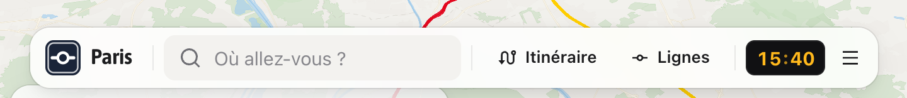
- **Localisation** : `web/src/ui/TopNavBar.tsx` (Desktop `>= 768px`).
- **Structure** : Conteneur `Panneau` (`flottant`, `h-12`, `rounded-[14px]`, `px-1.5`) regroupant la marque réseau, la recherche, les rubriques et le menu.
- **Note d’audit** : Dans `SubwayAppShell.tsx`, `TopNavBar` est appelé avec `compact={true}` et sans `onReseau`. De ce fait, le bloc « Paris » à gauche est actuellement un `
` statique (et non un `<button>` cliquable), et le sélecteur `Simple / Passionné` est déporté dans `MenuPrincipal`.

#### 2. Déclencheur de Recherche (`SearchTrigger`)
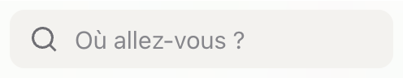
- **Utilité** : Point d’entrée unique vers la palette de recherche (`StationSearchPalette`) pour chercher une station, une ligne, un lieu ou lancer un itinéraire.
- **Charte graphique** :
  - Bouton natif `<button id="topbar-search-trigger">` stylé comme un champ de saisie.
  - Dimensions : `!h-9` (36px) × `236px` dans `TopNavBar` (ou `h-11` / `h-12` pleine largeur sur mobile).
  - Couleurs : fond `bg-encart` (`#f3f2ef` / `#27292f`), icône loupe `text-icone-2`, texte placeholder `text-encre-3` (`15px` ou `16px`), rayon `9px` (desktop) / `10px` (mobile).
  - Curseur : `cursor-text` pour simuler un input.
- **Dynamiques** : Hover `bg-encart-survol` (`150ms ease-signal`). Clic ou raccourci `⌘K` / `/` ouvre la modale de recherche.
- **Piste redesign** : Indiquer visuellement le raccourci clavier `⌘K` sur desktop (actuellement masqué) ou renforcer le contraste du placeholder `encre-3`.

#### 3. Bouton Rubrique « Itinéraire » (`TopNavBar`)
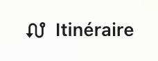
- **Utilité** : Ouvre ou ferme le tiroir de calcul d’itinéraire (`RoutePlannerDrawer`).
- **Charte graphique** : `Button` variante `discret`, taille `sm` (`h-8`, `13px` semibold, rayon `8px`), icône `RiRouteLine` (`16px`). Sur tablette (`768px–1023px`), bascule automatiquement en `IconButton` sans texte.
- **Dynamiques** : État `pressed={actif === 'itineraire'}` applique le style `PRESSED` (fond bleu/blanc translucide + texte accentué).

#### 4. Bouton Rubrique « Lignes » (`TopNavBar`)
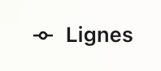
- **Utilité** : Ouvre ou ferme l’explorateur des lignes (`LinesDock`).
- **Charte graphique** : Identique au bouton Itinéraire (`Button` `discret` `sm`, icône `RiGitCommitLine`).
- **Dynamiques** : Lorsqu’une ligne est sélectionnée (`ligneActive`), l’icône générique est dynamiquement remplacée par la pastille colorée de la ligne (`LineBadgeChip size="xs"`).

#### 5. Bouton Menu et Réglages (`TopNavBar`)
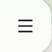
- **Utilité** : Ouvre/ferme le panneau non-modal `MenuPrincipal` (affichage, thème, bâtiments 3D, changement de ville/réseau, À propos).
- **Charte graphique** : `IconButton` variante `discret`, taille `sm` (`32×32px`, rayon `8px`), icône `RiMenuLine` (`16px`).
- **Dynamiques** : `expanded={menuOuvert}` applique `aria-expanded` et le style `PRESSED` tant que le menu est ouvert.

#### 6. Interrupteur Temps Réel (`InterrupteurDirect` dans `BandeauTelemetrie`)
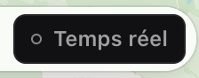
- **Utilité** : Bascule entre les données temps réel (PRIM / TfL / WMATA / VBB) et les horaires théoriques GTFS. Visible uniquement en mode **Passionné**.
- **Charte graphique** :
  - `<button role="switch" aria-checked={direct}>` utilisant la signature `afficheur` (verre noir `#111113`, bordure interne blanche 8%, `h-7` = 28px, `px-2.5`, `rounded-[7px]`, `text-[12px] font-semibold`).
  - Pastille LED à gauche (`size-1.5 rounded-full`) : ambre `#ffb81c` (`bg-ambre-500`) quand actif, cercle évidé blanc 50% quand inactif.
  - Libellé constant (« Temps réel PRIM ») : texte ambre si actif, blanc 60% si inactif.
- **Dynamiques** : Hover ajoute un contour lumineux `inset 0 0 0 1px rgb(255 255 255 / 0.22)`. Si le réseau n’a pas de temps réel, devient un `` non-cliquable « Horaires théoriques ».

---

### B. Menu Principal & Modales

#### 7. Menu Principal (`MenuPrincipal`) — Vue globale
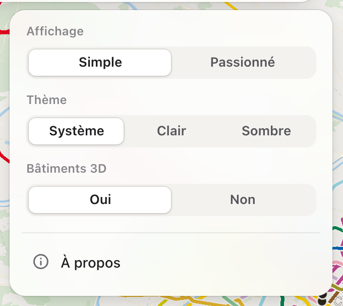
- **Localisation** : `web/src/ui/MenuPrincipal.tsx`.
- **Utilité** : Regroupe tous les réglages instantanés (sans bouton « Valider ») : niveau de détail, thème, bâtiments 3D, sélection du réseau et accès « À propos ».
- **Charte graphique** : `Panneau` `320px` de large, `p-3`, animation d’entrée `animate-feuille` (`240ms ease-portes`).

#### 8. Contrôle Segmenté (`Segmented` : Affichage / Thème / Bâtiments 3D)
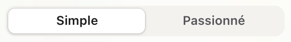
- **Utilité** : Sélecteur exclusif (`role="radiogroup"`) pour choisir entre 2 ou 3 options (`Simple` / `Passionné`, `Système` / `Clair` / `Sombre`, `Oui` / `Non`).
- **Charte graphique** :
  - Piste `bg-encart`, `h-8` (`sm`) ou `h-10` (`md`), `p-[3px]`, `rounded-controle` (`10px`).
  - Boutons `<button role="radio">` : texte `13px` semibold, `text-encre` si actif, `text-encre-2` sinon.
  - Curseur actif (`` absolu) : `bg-surface`, `rounded-[7px]`, glaçure + ombre portée légère.
- **Dynamiques** : Le curseur glisse horizontalement via `transform: translateX(...)` en `300ms ease-portes` (très fluide). Pilotable aux flèches gauche/droite du clavier.

#### 9. Bouton « À propos » (`MenuPrincipal`)
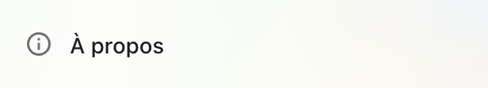
- **Utilité** : Ferme le menu et ouvre `AProposModale` (méthode de calcul, sources open data, licences).
- **Charte graphique** : Bouton pleine largeur (`h-11` = 44px, `rounded-[10px]`, `px-2.5`), texte `14px font-medium text-encre`, icône `RiInformationLine` (`18px`, `text-icone-2`). Hover `bg-encart`.

#### 10. Bouton Fermer de Modale (`Modale`)
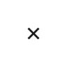
- **Localisation** : `web/src/ui/Modale.tsx` (utilisé par `AProposModale`, `RecordsModale`, `ShareItineraryModal`).
- **Utilité** : Unique sortie visuelle de la modale (complétée par `Échap` et le clic sur le backdrop).
- **Charte graphique** : `IconButton` `discret` `sm` (`32×32px`), icône `RiCloseLine`.

#### 11. Boutons de Partage (`ShareItineraryModal`)
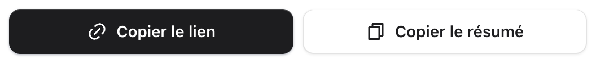
- **Localisation** : `web/src/ui/ShareItineraryModal.tsx`.
- **Utilité** : Partager un itinéraire calculé via la feuille native OS (si disponible), copier l’URL ou copier le résumé textuel.
- **Charte graphique** :
  - Grille 2 colonnes (`gap-2`) avec `Button` `md` `fullWidth` : `Copier le lien` en `primaire` (si pas de partage natif) ou `secondaire`, et `Copier le résumé` en `secondaire`.
- **Dynamiques** : Au clic, l’icône (`RiLink` / `RiFileCopyLine`) et le libellé basculent vers `RiCheckLine` + « Lien copié » / « Copié » pendant un court délai.

---

### C. Contrôles de Carte

#### 12. Pile des Contrôles de Carte (`MapControls`)
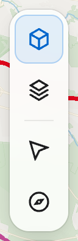
- **Localisation** : `web/src/ui/MapControls.tsx`, ancré en bas à droite sur desktop, en haut à droite sur mobile.
- **Charte graphique** : `Panneau` `flottant` vertical (`rounded-[14px]`, `p-1`, `gap-0.5`), chaque bouton étant un `IconButton` `discret` `md` (`40×40px`, `rounded-[10px]`). Séparateur `h-px bg-joint` entre les contrôles de vue 3D et de géolocalisation.

#### 13. Bouton « Vue 3D » (`MapControls`)
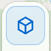
- **Utilité** : Bascule l’inclinaison (pitch) de la carte entre vue plane 2D et vue perspective 3D.
- **Charte graphique** : `IconButton` `md` (`40×40px`), icône `RiBox3Line`.
- **Dynamiques** : `pressed={vue3d}` active le fond `bg-selection` et la couleur `text-selection-encre`. Lorsque `vue3d` est actif, révèle juste en dessous le bouton **Vue sous-sol (Rayon X)** (`RiStackLine`).

#### 14. Bouton « Ma position » (`MapControls`)
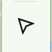
- **Utilité** : Active/désactive le suivi GPS continu de l’utilisateur sur la carte.
- **Charte graphique** : `IconButton` `md` (`40×40px`), icône `RiNavigationLine` (inactif) → `RiNavigationFill` (actif) + état `pressed`.
- **Note dynamique** : `MapControls` prévoit aussi conditionnellement un bouton **Nord** (`RiCompass3Line` dont l’icône pivote en temps réel selon `-cap` deg dès que la carte est tournée de > 1°), un bouton **Recentrer** (`RiFocus3Line`), et un `MenuBouton` **Points de vue** (`RiCameraLensLine`, actif sur Édimbourg).

#### 15. Boutons Zoom Avant / Zoom Arrière (`MapControls`)
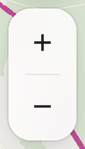
- **Utilité** : Zoome / dézoome la carte par paliers.
- **Charte graphique** : Deuxième `Panneau` `flottant` séparé (`hidden md:flex`, masqué sur mobile où le pinch-to-zoom suffit). Deux `IconButton` `md` (`RiAddLine` et `RiSubtractLine`) séparés par un `h-px bg-joint`.
- **Note d’audit** : Dans `SubwayAppShell.tsx`, `zoom={expertMode}` — ces boutons sont **masqués en mode Simple** et n’apparaissent qu’en mode Passionné.

---

### D. Explorateur de Lignes & Thermomètre

#### 16. Grille des Pastilles de Lignes (`LineBadgeChip` dans `LinesDock`)
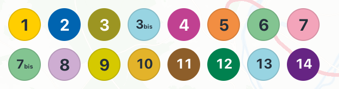
- **Localisation** : `web/src/ui/LinesDock.tsx` & `web/src/ui/LineBadgeChip.tsx`.
- **Utilité** : Sélectionner une ligne de Métro ou RER pour afficher son tracé sur la carte, son état de trafic, son profil d’élévation et son thermomètre temps réel.
- **Charte graphique** :
  - `<button type="button" aria-pressed={selected}>` reproduisant fidèlement la géométrie RATP/IDFM : **disque** (`rounded-full`) pour le Métro, **carré arrondi** (`rounded-[26%]`) pour le RER, avec couleur officielle et contraste texte calculé (`color` / `textColor`).
  - Taille `md` (`32×32px`, `16px` bold) dans `LinesDock`, avec filet interne subtil (`--fx-rim-clair` / `--fx-rim-sombre`).
  - Point d’alerte trafic en haut à droite (`size-3 ring-2 ring-surface`) : orange (`bg-vigilance`) ou rouge (`bg-signal`).
- **Dynamiques** : Hover `brightness-[1.05]`, clic `active:scale-[0.96]`. État `selected` ajoute un double anneau `2px surface + 2px encre`. Les lignes non sélectionnées peuvent être `dimmed` (`opacity-40 saturate-[0.35]`).

#### 17. Bouton Retour « Toutes les lignes » (`LinesDock`)
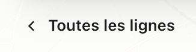
- **Utilité** : Revient du détail d’une ligne (`NiveauLigne`) vers la grille générale (`NiveauLignes`).
- **Charte graphique** : `Button` `discret` `sm` (`h-8`, `13px` semibold), icône `RiArrowLeftSLine`.

#### 18. Bouton « Inverser la direction » (`LinesDock`)
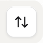
- **Utilité** : Inverse le sens de parcours affiché sur le `Thermometre` (ex: La Défense ↔ Château de Vincennes) et recalcule les rames dans ce sens.
- **Charte graphique** : `IconButton` `secondaire` `sm` (`32×32px`, fond `bg-surface`, bordure `OUTLINED`), icône `RiArrowUpDownLine`. Placé à droite dans un encart `bg-encart` (`rounded-[10px]`).

#### 19. Bouton Arrêt & Correspondances (`Thermometre`)
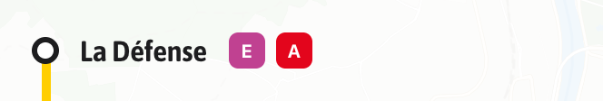
- **Localisation** : `web/src/ui/Thermometre.tsx`.
- **Utilité** : Cliquer sur le nom d’une station ouvre sa `StationDrawer` ; cliquer sur une pastille de correspondance (`LineBadgeChip size="xs"`, `20×20px`) bascule directement vers cette autre ligne.
- **Charte graphique** :
  - Bouton arrêt : `<button>` pleine largeur de texte (`signaletique`, `15px font-medium` ou `16px font-[650]` pour les terminus), `rounded-[6px] px-1.5 py-0.5`, hover `bg-encart`.
  - Pastilles de rame (`RameThermo`) : petits rectangles dynamiques (`14×19px`, ou `17×24px` si suivie) aux couleurs de la ligne avec flèche directionnelle, positionnés en `top` avec `transition-[top,transform] duration-500 ease-rame` et `hover:scale-110`.

#### 20. Bouton « Monter à bord » (`LinesDock`)
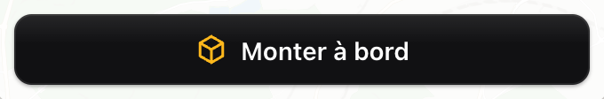
- **Utilité** : Lance la vue 3D embarquée (`CabHud`) sur une rame de la ligne sélectionnée (Paris uniquement).
- **Charte graphique** : `Button` variante **`afficheur`**, taille `md` (`h-10`), `fullWidth`, icône `RiBox3Line` en ambre `#ffb81c`, fond noir vitré `#111113` avec reflet haut et halo ambre au survol. Placé en pied de tiroir fixe (`border-t border-joint`).

---

### E. Fiche Station & Prochains Passages

#### 21. Actions d’En-tête de Station (`StationDrawer` : Favori, Plus d’actions, Fermer)
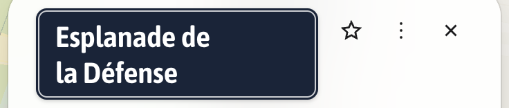
- **Localisation** : `web/src/ui/StationDrawer.tsx`.
- **Utilité** :
  - **Favori** : ajoute/retire la station des favoris (`RiStarLine` → `RiStarFill`, `pressed={!!favori}`).
  - **Plus d’actions** (`MenuBouton`) : ouvre le menu secondaire (`RiMore2Line`).
  - **Fermer** : ferme la fiche station (`RiCloseLine`).
- **Charte graphique** : Trois `IconButton` `discret` `sm` (`32×32px`) alignés à droite de la `Plaque` bleue ardoise de la station.

#### 22. Menu « Plus d’actions » (`MenuBouton` dans `StationDrawer`)
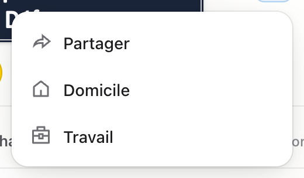
- **Localisation** : `web/src/ui/Menu.tsx`.
- **Utilité** : Actions secondaires (Partager, Définir/Retirer comme Domicile, Définir/Retirer comme Travail).
- **Charte graphique** : Popover `min-w-[240px]`, `rounded-[14px]`, `bg-surface-elevee`, `p-1.5`, ombre `--shadow-flotte`, animation `animate-feuille`. Chaque entrée est un `<button role="menuitem">` de `h-10` (40px), `rounded-[9px]`, `px-2.5`, `14px font-medium`, icône `18px` `text-icone-2`, hover `bg-encart`.

#### 23. Pastilles de Lignes Cliquables (`StationDrawer`)
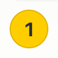
- **Utilité** : Naviguer directement vers la fiche d’une ligne desservant la station.
- **Charte graphique** : `LineBadgeChip` taille `md` (`32×32px`), mêmes dynamiques de survol et d’alerte que dans `LinesDock`.

#### 24. Afficheur SIEL Cliquable (`Afficheur` dans `Passages`)
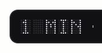
- **Localisation** : `web/src/ui/Afficheur.tsx` & `web/src/ui/Passages.tsx`.
- **Utilité** : En mode **Passionné**, chaque temps d’attente affiché dans le tableau des prochains passages est un `<button>` qui déclenche le suivi de la rame correspondante (`onSuivre` → `FollowTrainHud`). En mode Simple, reste un `` non-interactif.
- **Charte graphique** :
  - Boîtier `afficheur` (verre noir `#111113`, `rounded-[7px]`, bordure blanche 8%).
  - Cellule cliquable (`CELL.sm`: `h-7 min-w-[30px] px-1.5`) avec chiffres ambre `#ffb81c` (temps réel) ou blanc cassé `#e5e5ea` (théorique), ou état pulsant `animate-approche` à l’approche.
  - Hover : `hover:bg-white/10`. Focus : `focus-visible:[box-shadow:inset_0_0_0_2px_var(--color-email-300)]`.

#### 25. Actions de Pied de Fiche Station (`Y aller`, `Partir d’ici`, `Quai 3D`)
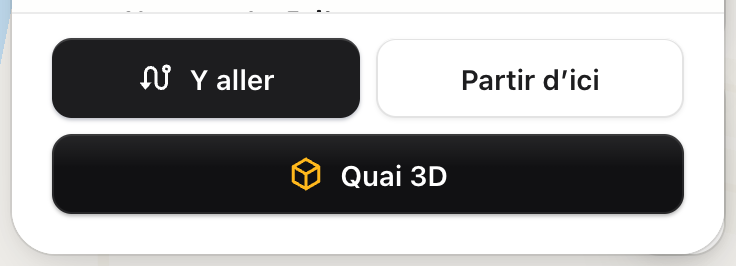
- **Utilité** :
  - **Y aller** : ouvre le calculateur d’itinéraire avec cette station en Arrivée.
  - **Partir d’ici** : ouvre le calculateur d’itinéraire avec cette station en Départ.
  - **Quai 3D** *(Paris uniquement)* : téléporte la caméra sur le quai 3D de cette station (`CabHud` en mode Quai).
- **Charte graphique** :
  - Desktop : grille 2 colonnes (`Y aller` en `primaire` `md` + `Partir d’ici` en `secondaire` `md`) au-dessus de `Quai 3D` en `afficheur` `md` `fullWidth`.
  - Mobile : grille 1 ligne `grid-cols-[1.15fr_1fr_auto]` avec `min-h-[44px]` pour respecter les cibles tactiles iOS.

---

### F. Calculateur d’Itinéraire

#### 26. Bouton « Inverser départ et arrivée » (`RoutePlannerDrawer`)
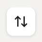
- **Localisation** : `web/src/ui/RoutePlannerDrawer.tsx`.
- **Utilité** : Permute les champs A (Départ) et B (Arrivée) et recalcule le trajet.
- **Charte graphique** : `IconButton` `secondaire` `sm` (`32×32px`), icône `RiArrowUpDownLine`, positionné à cheval à droite entre les deux champs (`absolute right-2.5 top-1/2 -translate-y-1/2`).

#### 27. Boutons « Partir de ma position » & « Effacer le champ » (`RoutePlannerDrawer`)

- **Utilité** :
  - Lorsque le champ Départ est vide : affiche `IconButton` `discret` `sm` (`RiFocus3Line`, « Partir de ma position »).
  - Lorsque le champ contient du texte : affiche un `<button>` circulaire avec `RiCloseCircleFill` (`18×18px`, `text-icone-2 hover:text-encre`) pour vider la saisie.

#### 28. Raccourcis « Domicile », « Travail » & Favoris (`RoutePlannerDrawer`)
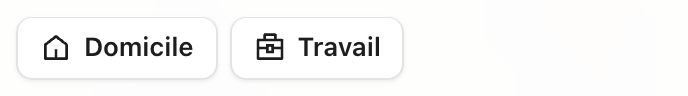
- **Utilité** : Remplit instantanément la destination (ou le départ) avec l’adresse enregistrée Domicile, Travail ou jusqu’à 4 stations favorites.
- **Charte graphique** : `Button` `secondaire` `sm` (`h-8`, `13px`), icônes `RiHome5Line`, `RiBriefcase4Line`, `RiStarFill`.

#### 29. Carte d’Itinéraire Repliable (`CarteItineraire` dans `RoutePlannerDrawer`)
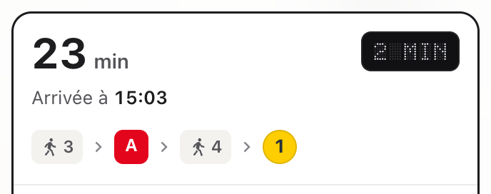
- **Utilité** : Sélectionne un des trajets proposés et déplie son détail étape par étape (`PlanDeLigne` + trace sur la carte).
- **Charte graphique** :
  - `<button aria-expanded={ouverte}>` pleine largeur (`p-3.5 text-start`) dans un `<li>` `rounded-[14px] bg-surface`.
  - État fermé : bordure `1px` `--color-bord` (hover `--color-bord-fort`).
  - État ouvert : bordure `1.5px` `--color-encre` + ombre légère. Affiche la durée en `30px bold chiffres`, l’heure d’arrivée, l’`Afficheur` d’attente, les pastilles de correspondance et les alertes trafic.

#### 30. Bouton Déplier les Arrêts Intermédiaires (`PlanDeLigne`)
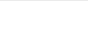
- **Localisation** : `web/src/ui/PlanDeLigne.tsx`.
- **Utilité** : Révèle la liste complète des arrêts intermédiaires d’un tronçon sur la ligne verticale.
- **Charte graphique** : `<button>` discret `px-1.5 py-1 rounded-[6px] text-[13px] font-semibold text-encre-2 hover:bg-encart hover:text-encre`.

#### 31. Bouton « Aperçu 3D » de Tronçon (`RoutePlannerDrawer`)
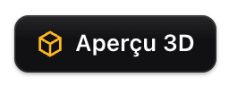
- **Utilité** : Lance la vue 3D (`CabHud`) directement sur ce tronçon précis de l’itinéraire.
- **Charte graphique** : `Button` `afficheur` `sm` (`h-8`), icône `RiBox3Line` ambre.

#### 32. Bouton « Partager » (`RoutePlannerDrawer`)
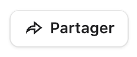
- **Utilité** : Ouvre `ShareItineraryModal` pour le trajet actif.
- **Charte graphique** : `Button` `secondaire` `sm` (ou `min-h-[42px]` sur mobile) dans le footer fixe, icône `RiShareForwardLine`.

---

### G. Suivi de Rame

#### 33. Contrôles du HUD Suivi de Rame (`FollowTrainHud`)
- **Localisation** : `web/src/ui/FollowTrainHud.tsx`.
- **Utilité** : Carte flottante affichée lorsqu’on suit une rame en direct (depuis le `Thermometre`, la carte ou un `Afficheur` en mode Passionné).
- **Boutons présents** :
  1. **Arrêter le suivi** : `IconButton` `discret` `sm` (`RiCloseLine`) en haut à droite.
  2. **Monter à bord** *(Paris uniquement)* : `Button` `afficheur` `sm` (`RiBox3Line`), permet de passer directement du suivi carte 2D à l’intérieur de la rame en 3D.
  3. **Arrêts sur le ruban horizontal** (`PlanDeLigneHorizontal`) : si `onSelectStop` est fourni, chaque point d’arrêt et son libellé deviennent des `<button>` cliquables.

---

### H. Vue 3D Quai & Cabine (`CabHud`)

> **Particularité charte** : Tout `CabHud` est enveloppé dans `class="dark"` avec la matière `verre` (`rgb(22 23 27 / 0.80)` + `blur(22px)`). Il reste sombre en permanence, même lorsque le site est en mode Jour.

#### 34. Bouton « Carte [Esc] » / Quitter la 3D (`CabHud`)
- **Localisation** : `web/src/ui/CabHud.tsx` (`[data-ride-exit]`).
- **Utilité** : Quitte la scène Three.js et revient à la carte 2D/3D MapLibre.
- **Charte graphique** :
  - **Desktop** : `Button` `discret` `md` dans le `Panneau` `verre` en haut à droite, avec icône `RiLogoutBoxRLine` et badge `<Kbd>Esc</Kbd>`.
  - **Mobile** : `IconButton` `secondaire` circulaire (`verre min-h-[44px] min-w-[44px] rounded-full`, icône `RiCloseLine`) flottant en haut à gauche.

#### 35. Bouton « Point de vue » (ex: Tour Eiffel) (`CabHud`)
- **Localisation** : `web/src/ui/CabHud.tsx` (`[data-ride-eiffel]`).
- **Utilité** : Téléporte ou oriente la caméra vers un point de vue remarquable du parcours (ex : viaduc de la ligne 6 face à la Tour Eiffel).
- **Charte graphique** : `Button` `secondaire` `sm`, icône `RiEyeLine`.

#### 36. Barre de Contrôles de Conduite & Caméra (`CabHud`)
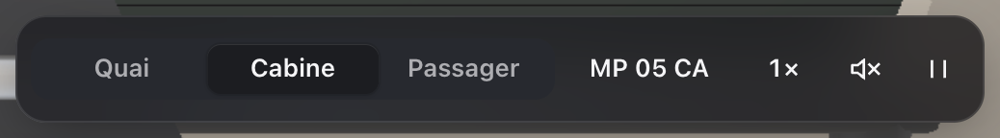
- **Localisation** : En bas à droite (Desktop) ou intégrée au HUD unifié en bas (Mobile).
- **Boutons présents** :
  1. **Sélecteur de vue (`Segmented` `sm`)** : `Quai` / `Cabine` / `Passager` (`w-[272px]` desktop, `w-[208px]` mobile).
  2. **Matériel roulant (`[data-ride-stock]`)** : `Button` `discret` `sm` `chiffres` (ex: `MP 89`), permet de cycler le modèle 3D de train.
  3. **Allure (`[data-ride-speed]`)** : `Button` `discret` `sm` `chiffres` (ex: `×1`, `×2`), change la vitesse de simulation.
  4. **Son moteur (`[data-ride-audio]`)** : `IconButton` `discret` `sm` (desktop) / `md` `min-44px` (mobile), `RiVolumeUpLine` / `RiVolumeMuteLine`.
  5. **Pause / Reprendre (`[data-ride-pause]`)** : `IconButton` `discret` `sm` (desktop) / `md` `min-44px` (mobile), `RiPauseLine` / `RiPlayLine`.

#### 37. Interrupteur Temps Réel en Cabine (`CabHud`)
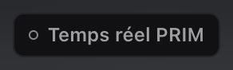
- **Utilité** : Identique à `InterrupteurDirect` dans `BandeauTelemetrie`, mais intégré dans le panneau télémétrie en bas à gauche de la vue 3D (`[data-ride-live]`).

#### 38. Arrêts Cliquables sur le Ruban Horizontal (`PlanDeLigneHorizontal` dans `CabHud`)
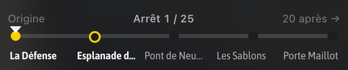
- **Utilité** : Cliquer sur une pastille d’arrêt (`10px` / `12px`, `hover:scale-125`) ou sur le nom d’une station téléporte la rame/caméra à cette station.

---

### I. Spécificités Mobile (`< 768px`)

#### 39. Pilule Menu Flottante Mobile (`SubwayAppShell`)
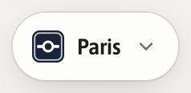
- **Utilité** : Remplace `TopNavBar` sur mobile : affiche le logo `Marque`, le nom de la ville, un point vert/gris d’état temps réel, et un chevron qui pivote à 180° à l’ouverture de `MenuPrincipal`.
- **Charte graphique** : `<button>` `flottant` `rounded-pill` `min-h-[42px] px-3 py-1.5 text-[14px] font-semibold`.

#### 40. Bouton Replier / Déplier le BottomSheet (`BottomSheet`)
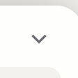
- **Utilité** : Bascule rapidement entre l’état `repli` (pour admirer le plan 3D) et l’état `bas` sans avoir à glisser la poignée tactile.
- **Charte graphique** : `<button>` `size-11` (`44×44px` tactile), `rounded-controle`, `text-icone-2 hover:bg-encart hover:text-encre`, icône `RiArrowDownSLine` / `RiArrowUpSLine`. Positionné en haut à droite du `BottomSheet` à côté de la poignée de glissement (`<button>` tactile `h-8 w-full`).

#### 41. Barre Repliée Mobile (`MobileHomeSheet` — `barreRepli`)
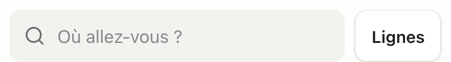
- **Utilité** : Quand la feuille d’accueil mobile est repliée, conserve un accès en 1 tap à la recherche (`SearchTrigger`) et au déploiement des lignes (`Button` `secondaire` `md` `min-h-[44px]` « Lignes »).

#### 42. Grille des 4 Raccourcis Mobiles (`MobileHomeSheet` — `RaccourciBouton`)
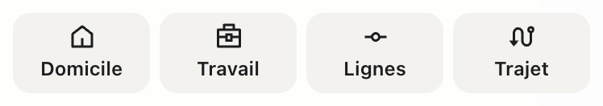
- **Utilité** : Accès rapide en 4 colonnes égales vers `Domicile`, `Travail`, `Lignes` et `Trajet`.
- **Charte graphique** : `<button>` vertical (`min-h-[44px]`, `rounded-[11px]`, `px-1.5 py-1.5`, `text-[12px] font-semibold`, icône `18px`), fond `bg-encart` (hover `bg-encart-survol`), ou `bg-selection text-selection-encre` si actif (Domicile/Travail déjà configuré).

#### 43. Bouton « Annuler » de la Recherche Mobile (`StationSearchPalette`)
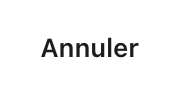
- **Utilité** : Ferme la palette de recherche plein écran sur mobile (où la touche `Échap` n’existe pas, remplaçant le badge `<Kbd>Échap</Kbd>` affiché sur bureau).
- **Charte graphique** : `Button` `discret` `sm` (« Annuler »).

---

## Synthèse des Points d’Attention pour le Redesign

1. **Cohérence Boutons Natifs vs `Button`** : Plusieurs boutons clés (`SearchTrigger`, `RaccourciBouton`, `ReseauButton`, `CarteItineraire`, pilule menu mobile, `Thermometre` arrêts/rames) sont des `<button>` natifs avec des classes Tailwind ad hoc plutôt que des variantes de `Button.tsx`. Unifier ou documenter ces exceptions évitera les dérives d’espacement et d’états `active`/`focus`.
2. **Visibilité des contrôles en mode Simple** : Les boutons Zoom `+/-` de `MapControls` et l’`InterrupteurDirect` sont masqués en mode Simple ; sur desktop sans trackpad, l’absence de boutons `+/-` peut gêner.
3. **Redondance `Lignes` sur Mobile** : Sur `MobileHomeSheet`, le raccourci « Lignes » coexiste avec la grille de pastilles Métro/RER juste en dessous dès le cran `moyen`.
4. **Cibles tactiles sur Desktop vs Mobile** : Les boutons `sm` (`32px`) sont parfaits sur bureau (`TopNavBar`, `StationDrawer` header, `LinesDock` header), mais nécessitent systématiquement une surcharge `min-h-[44px]` sur mobile (`StationDrawer` footer, `CabHud` mobile, `BottomSheet` collapse).
