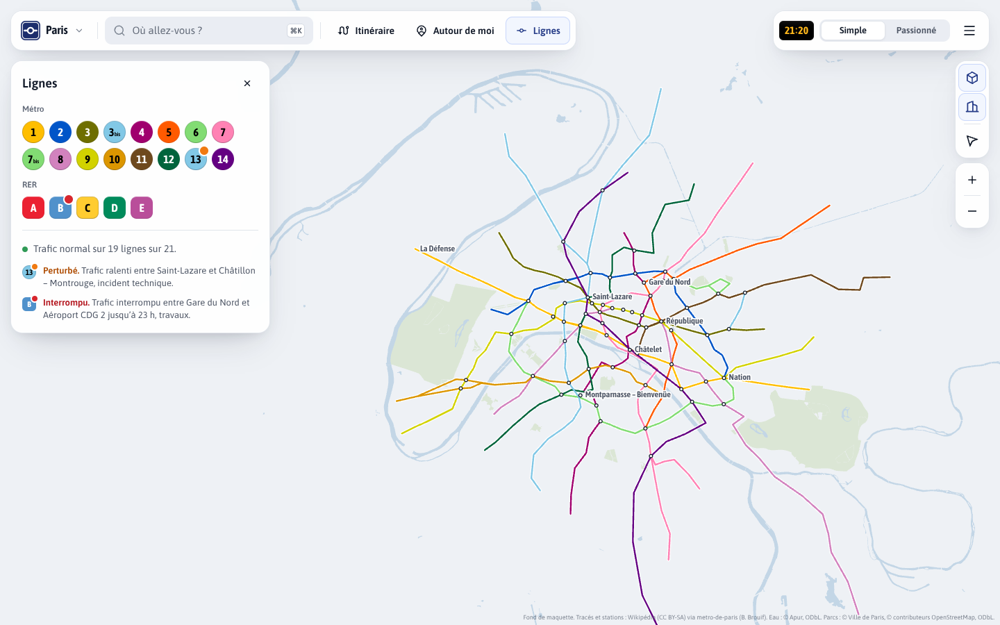

# Faïence — charte graphique de Métro & RER Parisiens 3D (v2)

> Une interface qui se lit comme une station : l’émail pour nommer, l’afficheur pour dire le temps, la faïence pour tout le reste.



La v2 remplace l’identité « Warm-Neutral + Laiton ». Elle s’appuie sur ce que les voyageurs lisent réellement sur les quais : les plaques émaillées des stations, les écrans de prochains passages (chiffres ambre sur fond noir, terminus d’abord, trait épais à la couleur de la ligne, trois points « à l’approche ») et la faïence blanche biseautée. Rien n’est copié des marques déposées : tout part de conventions publiques, de matières et de l’open data.

La planche vivante est `design/showcase.html`. C’est un seul fichier, à ouvrir dans un navigateur : il est construit à partir des vrais composants et calcule les contrastes en direct. Le détail des jetons et des API se trouve dans **[TOKENS_ET_COMPOSANTS.md](TOKENS_ET_COMPOSANTS.md)**, la marche à suivre dans **[MIGRATION.md](MIGRATION.md)**.

**v2.1.** L’arbitrage du layout et des boutons ([`docs/arbitrage_faience_v2.md`](../docs/arbitrage_faience_v2.md)) est appliqué : fiche station à trois boutons, une entrée 3D par sujet, réglages dédoublonnés, et quatre écrans ajoutés (suivi de rame, Autour de moi, recherche ⌘K, modales d’information).

---

## 1. Trois matières

| Matière | Rôle | Où on la trouve | Ce qu’elle ne fait jamais |
| :--- | :--- | :--- | :--- |
| **Émail** — bleu `#1C2D6C`, filet blanc intérieur | Nommer un lieu, porter l’action principale | Plaque de la fiche station, plaque de la cabine, bouton « Y aller », marque de l’app | Décorer. Une seule plaque par écran. |
| **Afficheur** — verre noir, chiffres ambre `#FFB81C` | Dire le temps qui reste, en direct | Prochains passages, attente d’un itinéraire, horloge, vitesse en cabine, bouton « Voir le quai en 3D » | Servir d’accent. L’ambre n’existe que sur ce noir. |
| **Faïence** — blanc émaillé, joints ardoise | Porter tout le reste | Panneaux, feuilles, champs, listes séparées par des joints | Empiler des cartes identiques. |

La couleur vive appartient aux **lignes** (open data IDFM) et aux **états du trafic**. Le reste de l’interface est en ardoise et en émail, ce qui rend les lignes lisibles d’un coup d’œil.

## 2. Pourquoi la v1 change

| Constat v1 | Mesure | Réponse v2 |
| :--- | :--- | :--- |
| Anneau de focus laiton `#c9a227` | **2,42 : 1** sur blanc, sous le minimum WCAG de 3 : 1 | Focus émail-600 : 7,54 : 1 de jour ; émail-300 : 9,01 : 1 de nuit |
| Laiton comme accent jaune | Se confond avec l’ambre des écrans de quai et devient boueux en thème sombre | Le laiton devient une matière 3D (mains courantes, Sprague) et quitte l’interface |
| Passages en cartes empilées, directions mélangées | Dix cartes pour trois lignes, sans ordre | Une ligne par ligne et par terminus, deux passages, séparées par des joints |
| Recherche mobile tronquée en « O… » | Illisible à 390 px | Barre basse pleine largeur, dans la zone du pouce |
| « Temps réel & GTFS » | Le voyageur ne sait pas ce qui est fiable | Ambre : en direct. Blanc : horaire théorique. |
| Switzer | Grotesque neutre, sans axe de largeur | Asap, une famille, deux largeurs |
| « Sauver », « Aller ici (B) », « Rame : Milieu » | Anglicisme, jargon interne | Voir § 11 |

## 3. Principes

1. **Nommer en émail.** Le lieu dont parle l’écran porte une plaque. Un seul par écran.
2. **Dire le temps en ambre.** Ambre sur noir signifie « en direct ». Rien d’autre n’est ambre.
3. **Diriger par le terminus.** À Paris, on prend une ligne « direction Château de Vincennes ». Le terminus est toujours écrit, en Signalétique.
4. **La couleur appartient aux lignes.** L’interface reste en ardoise et en émail ; les lignes et les états du trafic portent la couleur.
5. **Une action principale par vue.** Un seul bouton `primaire`. Un seul bouton `afficheur`, qui fait entrer dans le monde ferroviaire.
6. **Des matières, pas des effets.** Pas de dégradé décoratif. Les seuls reflets décrivent une matière : le brillant de l’émail, le liseré de la faïence, le verre du HUD.

## 4. Couleurs

Palette noyau (les rampes complètes sont dans TOKENS_ET_COMPOSANTS.md, § 2) :

| Nom | Hex | Rôle |
| :--- | :--- | :--- |
| Émail 800 | `#1C2D6C` | Plaques, action principale de jour |
| Ardoise 900 | `#111928` | Encre principale |
| Ardoise 50 | `#F4F6F9` | Fond de carte et de page, jour |
| Faïence | `#FFFFFF` | Surfaces |
| Nuit 900 | `#0C1222` | Fond de nuit (le tunnel, pas un noir neutre) |
| Ambre 500 | `#FFB81C` | Chiffres en direct, sur noir uniquement |

**Rampes.** Émail, Ardoise et Nuit sont calculées en OKLCH à teinte constante (268 et 262), puis ramenées dans le gamut sRGB. Le script `design/tools/palette.mjs` régénère les valeurs et le rapport de contraste (`node design/tools/palette.mjs report`, nécessite `culori`).

**États du trafic.** Normal `#2F9A56`, vigilance `#F07A12`, signal `#D7262D`. Chacun a une variante pour le texte de jour (700) et de nuit (300). Un état n’est jamais porté par la couleur seule : la pastille garde son nom (« Ligne 13, trafic perturbé ») et le message est écrit.

**Contrastes vérifiés** (WCAG 2.2, calculés dans la planche) :

| Paire | Ratio | Seuil |
| :--- | ---: | ---: |
| Encre sur faïence | 17,59 : 1 | 4,5 |
| Encre 2 (`ardoise-600`) sur faïence | 7,27 : 1 | 4,5 |
| Encre 3 (`ardoise-500`) sur encart, pire cas | 4,51 : 1 | 4,5 |
| Icône secondaire (`ardoise-450`) sur faïence | 3,62 : 1 | 3 |
| Blanc sur émail | 12,79 : 1 | 4,5 |
| Ambre sur afficheur | 12,12 : 1 | 4,5 |
| Encre de nuit sur surface de nuit | 15,49 : 1 | 4,5 |
| Encre 3 de nuit sur surface de nuit | 5,67 : 1 | 4,5 |
| Focus, jour et nuit | 7,54 et 9,01 : 1 | 3 |

**Lignes.** Les couleurs viennent du flux GTFS d’IDFM (`route_color`, `route_text_color`). La table de `lines.ts` ne sert que de repli hors ligne. Une pastille est un pictogramme : son seuil est 3 : 1, et l’encre officielle est conservée dès qu’elle l’atteint (le RER B reste blanc sur bleu, 3,36 : 1). Un liseré n’apparaît que si la couleur se confond avec la surface : pastilles claires de jour, foncées de nuit.

## 5. Typographie

**Asap** (Omnibus-Type, SIL OFL 1.1), variable en graisse (100–900) et en largeur (75–125 %). Elle est auto-hébergée via Fontsource pour que la PWA garde sa typographie hors ligne. Elle a été retenue après un test de dix familles libres sur de vrais noms de stations et de vrais chiffres : c’est une humane, comme la lettre des transports français, sans en être une copie.

| Voix | Réglage | Usage |
| :--- | :--- | :--- |
| Texte | largeur 100 % | Phrases, libellés, boutons |
| Signalétique | largeur 80 %, classe `signaletique` | Noms de stations, terminus, plaques |
| Chiffres | tabulaires, largeur 82 %, classe `chiffres` | Minutes, heures, durées, pastilles |

Échelle (d’après Bringhurst) : `micro` 11/14 · `legende` 12/16 · `etiquette` 13/18 · `corps-sm` 14/20 · `corps` 16/24 · `titre-sm` 18/24 · `titre` 21/26 · `titre-lg` 24/28 · `affiche` 36/40, plus les chiffres d’afficheur 18, 24, 36 et 60. Les noms BoardUI (`text-body-2-regular`…) restent disponibles.

Règles de composition :
- tiret demi-cadratin entre deux termini ou deux noms (« Bagneux – Lucie Aubrac ») ;
- apostrophe typographique (« Partir d’ici ») ;
- « min » sous les chiffres, comme sur les écrans ;
- casse de la phrase partout, jamais de capitales pour les libellés.

## 6. Formes, matières, élévation

**Rayons.** Ils forment une hiérarchie, pas une valeur unique :
- 6 px pour les objets (plaques, afficheurs) ;
- 10 px pour les contrôles ;
- 16 px pour les panneaux ;
- 24 px pour les feuilles.

Les pastilles de métro sont des disques ; celles du RER des carrés à 28 %.

**Élévation, nommée par nature.**
- `pose` : contrôles posés sur la carte.
- `flotte` : panneaux au-dessus de la carte.
- `feuille` : tiroirs et feuilles basses.

De nuit, les ombres sont plus noires que le fond ; ce sont surtout les liserés qui séparent les plans.

**Recettes.**
- `plaque` : émail, filet blanc de 1,25 px inséré à 2 px, léger brillant dans le haut.
- `afficheur` : noir, reflet de verre sur 38 % de la hauteur.
- `faience` : surface, liseré de glaçure de 1 px en haut, joint de 1 px.
- `carrelage` : motif de carreaux 2:1 posés en quinconce, uniquement pour les états vides et les chargements.

## 7. Composants

La bibliothèque compte une vingtaine de composants, tous dans `web/src/ui`, et tous tournent dans la planche.

- **Primitives :** `LineBadgeChip`, `Button` et `IconButton`, `Plaque`, `Afficheur` avec `Horloge` et `Approche`, `InterrupteurDirect`, `Segmented`, `MenuBouton`, `Modale`, `Panneau` et `Joint`, `Kbd`, `SearchTrigger`, `Marque`, `formatNombre`.
- **Information voyageur :** `Passages`, `PlanDeLigne` (vertical et horizontal), `Thermometre`, `VoitureConseillee`, `BandeauTelemetrie`.
- **Écrans :** `TopNavBar`, `BarreMobile` et `MenuPrincipal`, `MapControls`, `LinesDock`, `StationDrawer`, `RoutePlannerDrawer`, `FollowTrainHud`, `NearbyDrawer`, `StationSearchPalette`, `AProposModale`, `RecordsModale`, `CabHud`.

API et exemples : TOKENS_ET_COMPOSANTS.md, § 6.

## 8. Mouvement

| Courbe | Valeur | Durée | Usage |
| :--- | :--- | :--- | :--- |
| `ease-portes` | `cubic-bezier(.32,.72,0,1)` | 320 ms | Feuilles, tiroirs, curseur du sélecteur |
| `ease-rame` | `cubic-bezier(.65,0,.35,1)` | 640 ms | Caméra, déplacements sur la carte, train du plan de ligne |
| `ease-signal` | `cubic-bezier(.2,0,0,1)` | 90–160 ms | Survol, pression, changement d’état |

Le mouvement répond à un geste. Le seul mouvement spontané est celui des trois points « à l’approche », parce qu’il porte une information. Un chiffre qui change remonte de 30 % en 220 ms. Tout s’arrête avec `prefers-reduced-motion`. `tokens.ts` exporte les mêmes courbes en fonctions (`easeRame`, `easePortes`) pour deck.gl et Three.js.

## 9. Carte

La carte est le sol sur lequel on dessine les lignes : elle doit s’effacer.

**Palette.** De jour, ardoise froide, Seine `#C3D6E6`, parcs `#DBE6D5`, bâti `#E3E7ED`. De nuit, encre `#0B1120`, eau `#0F213A`.

**Application.** `applyFaienceBasemap(map, 'jour' | 'nuit')` restyle tout style au schéma OpenMapTiles d’après les `source-layer`, ce qui résiste aux changements d’identifiants de couches.

**Tracé des lignes.**
- Chaque ligne repose sur un liseré à la couleur du fond.
- Largeurs selon le zoom : 1,4 px à l’échelle régionale, 9 px en ville.
- Extrémités et jointures arrondies.

**Stations.** Disque blanc, anneau d’encre. Les correspondances sont plus grandes.

**Étiquettes.** En Signalétique 650, avec un halo à la couleur du fond.

En mode itinéraire, les lignes hors trajet passent à 30 % d’opacité et le trajet est doublé.

## 10. 3D

`web/src/three/paris_palette.ts` fournit les matériaux physiques :
- faïence biseautée (vernis 0,65) ;
- plaques en émail (vernis 0,9) ;
- frises à la couleur de la ligne ;
- laiton et laiton patiné, inox, quai, bande d’éveil, voûte, tunnel, ballast, rail ;
- fonte verte des entourages de 1900.

Le fichier fournit aussi l’éclairage et le pupitre de cabine. `drawAfficheurVitesse(ctx, …)` dessine l’affichage de vitesse dans la même grammaire que l’interface : noir, ambre, Asap étroite. La station à l’écran et la station en 3D parlent la même langue.

Pour les totems de surface, n’utilisez pas le « M » cerclé. Inspirez-vous des candélabres Dervaux et des entourages Guimard, du domaine public, avec notre propre lettrage.

## 11. Rédaction

Des verbes simples, à la casse de la phrase. Un bouton dit ce qui va se passer et garde son nom tout au long du parcours. Une erreur dit ce qui s’est passé et comment s’en sortir, sans s’excuser.

| v1 | v2 |
| :--- | :--- |
| Sauver | Favori |
| Aller ici (B) / Partir (A) | Y aller / Partir d’ici |
| Quai 3D | Voir le quai en 3D |
| Zoom 3D | Centrer la carte en 3D (bouton icône) |
| Temps réel & GTFS | En direct, ou Horaires théoriques |
| Réseau en circulation | Trafic normal sur 19 lignes sur 21. |
| Rame : Milieu | Montez au milieu du train, pour la sortie rue de Lyon |
| Carte 3D (Esc) | Revenir à la carte |
| Définir Domicile | Définir le domicile |
| Direction X · 3 arrêts | Ligne 1 direction X, puis « 3 arrêts, 5 min » |
| Toutes | Toutes les lignes |
| Quitter (suivi de rame) | Arrêter le suivi (bouton ×) |
| Cabine 3D en direct / Voir la rame en 3D | Monter à bord |
| Cabine 3D (suivi de rame) | Monter dans cette rame |
| PRIM Live actif / PRIM Live (Théorique) | Temps réel PRIM (bascule) |
| Records du réseau, Top 5, Flop 5 | Records de fréquentation, Les plus fréquentées, Les moins fréquentées |
| À propos, Méthode & Simulation | À propos et méthode |

## 12. Accessibilité

- **Contrastes :** voir § 4. Tous les textes atteignent 4,5 : 1, tous les pictogrammes et anneaux de focus 3 : 1.
- **Focus :** visible partout, contour de 2 px décalé de 2 px. Le focus et la sélection ne se ressemblent pas : contour coloré d’un côté, anneau d’encre de l’autre.
- **Cibles :** 40 px au pointeur, 48 px au doigt sur mobile.
- **Afficheur :** chaque passage a sa phrase (« dans 2 minutes, puis dans 9 minutes », « à l’approche », « horaire théorique »).
- **Pastilles :** elles exposent « Ligne 4, trafic perturbé ».
- **Nom accessible :** il contient le libellé visible (WCAG 2.5.3). C’est pourquoi le bouton « Lignes » s’annonce « Lignes, choisir une ligne ».
- **Mouvement réduit :** respecté, les animations s’arrêtent et l’état reste.

## 13. Garde-fous juridiques

**Jamais :**
- la police Parisine, ni aucune police propriétaire de la RATP ou de la SNCF ;
- les logos RATP, SNCF et IDFM, le « M » cerclé, le logotype RER ;
- les pictogrammes officiels de ligne ;
- les jingles et voix d’annonce.

**Librement :**
- les couleurs de ligne, publiées en open data par IDFM ;
- les conventions de lecture : disque pour le métro, minutes d’attente, terminus ;
- les matières des stations ;
- le patrimoine du domaine public : Guimard, mort en 1942, et Dervaux, mort en 1945.

Les **fonds de carte des maquettes** utilisent des données ouvertes, qui ne concernent pas l’app :
- tracés et stations d’après Wikipédia (CC BY-SA), via le projet *metro-de-paris* ;
- eau : © Apur (ODbL) ;
- parcs : © Ville de Paris et contributeurs OpenStreetMap (ODbL).

Les captures `screenshots/maquettes/` héritent de ces licences. Le code et les jetons n’en dépendent pas.

## 14. Galerie (`screenshots/maquettes/`)

Ces maquettes sont rendues depuis `design/showcase.html` avec les vrais composants. Les vues cabine réutilisent vos rendus 3D, dont l’ancien HUD a été effacé.

| Vue | Fichier | Format |
| :--- | :--- | :--- |
| Planche complète | [`00_planche_charte.png`](screenshots/maquettes/00_planche_charte.png) | 1440 × page |
| Accueil, lignes et état du trafic | [`01_bureau_jour_accueil.png`](screenshots/maquettes/01_bureau_jour_accueil.png) | 1440 × 900 |
| Itinéraire Châtelet → Bastille, de nuit | [`02_bureau_nuit_itineraire.png`](screenshots/maquettes/02_bureau_nuit_itineraire.png) | 1440 × 900 |
| Fiche Strasbourg – Saint-Denis, Passionné, de nuit | [`03_bureau_nuit_station.png`](screenshots/maquettes/03_bureau_nuit_station.png) | 1440 × 900 |
| Cabine ligne 14, MP 14 CA | [`04_bureau_cabine_mp14.png`](screenshots/maquettes/04_bureau_cabine_mp14.png) | 1440 × 900 |
| Cabine ligne 9, MF 01, à quai | [`05_bureau_cabine_mf01.png`](screenshots/maquettes/05_bureau_cabine_mf01.png) | 1440 × 900 |
| Accueil mobile | [`06_mobile_accueil.png`](screenshots/maquettes/06_mobile_accueil.png) | 390 × 844 @2x |
| Fiche Bastille mobile | [`07_mobile_station.png`](screenshots/maquettes/07_mobile_station.png) | 390 × 844 @2x |
| Ligne 4, Passionné, thermomètre et télémétrie | [`08_bureau_jour_ligne.png`](screenshots/maquettes/08_bureau_jour_ligne.png) | 1440 × 900 |
| Suivi d’une rame | [`09_bureau_jour_suivi.png`](screenshots/maquettes/09_bureau_jour_suivi.png) | 1440 × 900 |
| Recherche ⌘K, de nuit | [`10_bureau_nuit_recherche.png`](screenshots/maquettes/10_bureau_nuit_recherche.png) | 1440 × 900 |
| À propos et méthode | [`11_bureau_jour_apropos.png`](screenshots/maquettes/11_bureau_jour_apropos.png) | 1440 × 900 |
| Records de fréquentation (chiffres de démonstration) | [`12_bureau_nuit_records.png`](screenshots/maquettes/12_bureau_nuit_records.png) | 1440 × 900 |
| Autour de moi | [`13_mobile_autour.png`](screenshots/maquettes/13_mobile_autour.png) | 390 × 844 @2x |
| Menu et réglages, mobile | [`14_mobile_menu.png`](screenshots/maquettes/14_mobile_menu.png) | 390 × 844 @2x |

## 15. Regénérer

```bash
npm run design:showcase                      # → design/showcase.html (fichier unique)
node design/capture_showcase.mjs maquettes   # → design/screenshots/maquettes/
npm run build:web && node design/capture_showcase.mjs app   # captures de l’app réelle
```

## 16. Fichiers

```
docs/arbitrage_faience_v2.md arbitrage du layout et des boutons (v2.1)
design/
  README.md                  cette charte
  TOKENS_ET_COMPOSANTS.md    jetons et API
  MIGRATION.md               passage de la v1 à la v2
  showcase.html              planche vivante, autonome
  showcase-src/              sources de la planche (Vite + React)
  capture_showcase.mjs       captures app et maquettes
  tools/palette.mjs          laboratoire de palette et rapport de contraste
  screenshots/maquettes/     rendus v2
web/styles/theme.css         jetons Tailwind v4 (primitives, sémantique, signatures)
web/styles/fonts.css         Asap auto-hébergée, police de repli calée
web/src/ui/                  composants React 19
web/src/design/tokens.ts     jetons pour Three.js, deck.gl et canvas
web/src/map/basemap_palette.ts
web/src/three/paris_palette.ts
```
